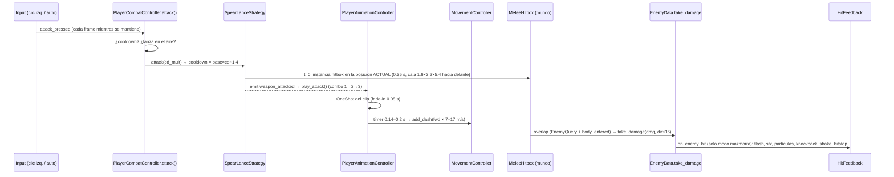
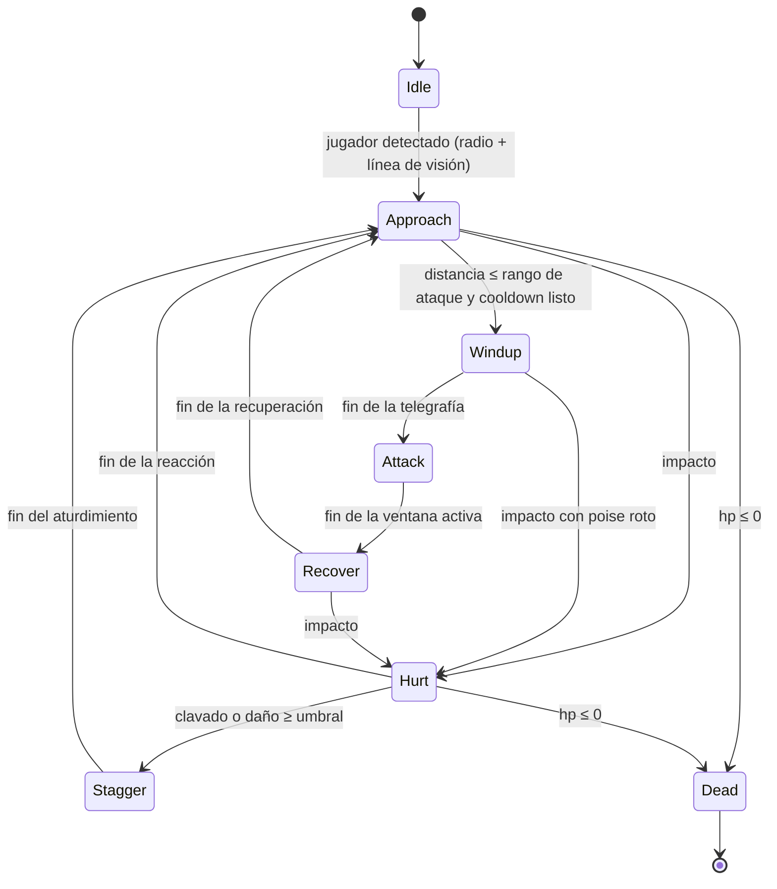

# AUDITORÍA Y REDISEÑO DEL COMBATE — MODO MAZMORRA (RUMBANG)

> Fecha: 2026-10-26 · Rama `developer` (con cambios sin commit) · Godot 4.7 / GDScript
> Ruta: `AUDITORIA_COMBATE_MAZMORRAS.md`
>
> **Alcance acordado**: el usuario pidió **saltar la Fase 1** (auditoría exhaustiva del código). El diagnóstico de §0 se basa en lo que se inspeccionó, programó y probó en esta misma sesión (los sistemas de combate de la mazmorra se escribieron aquí) y en tres comprobaciones puntuales hechas para este documento (`player.tscn`, `spear_lance_hitbox.tscn`, `auto_combat_controller.gd`, `enemy_registry.gd`). No es una auditoría línea a línea.
>
> **Etiquetas**: `[VERIFICADO]` (leído en el código o medido en ejecución en esta sesión) · `[INFERIDO]` (deducido del código, sin prueba) · `[PENDIENTE]` (requiere prueba).
>
> **Restricción respetada**: este documento no modifica código, escenas, recursos ni configuración.

---

## 0. Diagnóstico de partida (resumen, sin auditoría completa)

### 0.1 Flujo actual de un golpe de la Espalanza


### 0.2 Hallazgos de partida
| ID | Hallazgo | Etiqueta |
|---|---|---|
| D-01 | La hitbox nace **en t=0** (clic), pero el golpe visual de la animación llega después: estocada en el fotograma 8 de Blender (≈0,23 s), giro entre los fotogramas 8 y 16 (≈0,23–0,53 s) y clavado en el 15 (≈0,47 s). Los fotogramas salen de los scripts de pose usados en Blender (`blender_sources/mikeura_anims.blend`, 30 fps, la clave 1 es t=0) | [VERIFICADO desde las claves de animación] |
| D-02 | La hitbox queda **fija en el mundo** (hija del padre del jugador), mientras el dash mueve al jugador hasta unos 2,3 m. El golpe se queda atrás | [VERIFICADO en el código; impacto jugable PENDIENTE] |
| D-03 | Mantener el clic llama a `attack()` cada frame de física. El combo avanza al ritmo del cooldown (unos 1,05 s en la Espalanza). No hay ventana de enlace ni búfer de entrada: el combo es "clic mantenido = cadencia fija" | [VERIFICADO] |
| D-04 | `play_attack()` aborta y relanza el OneShot. Si el cooldown es menor que la duración del clip (attack2 = 33 fotogramas ≈ 1,1 s; attack3 = 34 ≈ 1,13 s), el ataque siguiente **corta** la recuperación del anterior | [VERIFICADO en el código] |
| D-05 | El ataque automático (`AutoCombatController`, radio 15 m, consulta `EnemyRegistry` cada 0,2 s) sigue activo en la mazmorra. Se crea si `combat_controller.is_auto_combat_enabled`, que siempre es `true` (`player.gd:263`) | [VERIFICADO] |
| D-06 | `HitFeedback.weapon_tag` es estático: lo fija cada punto de impacto antes de `take_damage`. Los ticks de estado alterado no lo fijan, pero se filtran como daño continuo (`is_dot`). Si se añade un punto de impacto y se olvida fijarlo, hereda el arma anterior | [VERIFICADO] |
| D-07 | `HitFeedback` controla `Engine.time_scale` (0,04 durante ≤0,12 s, en tiempo real). No hay otro dueño del `time_scale` en `scripts/`. La pausa (`get_tree().paused`) no lo restaura; se restaura en `_process`, que tiene `PROCESS_MODE_ALWAYS` | [VERIFICADO por grep en esta sesión; interacción con la pausa PENDIENTE] |
| D-08 | El feedback solo distingue **acierto**. Un ataque que falla no da ninguna señal propia: hay un `AudioManager.play("ataque-espalanza")` en cada ataque, acierte o no | [VERIFICADO] |
| D-09 | La mazmorra no tiene enemigos (`GameStartFacade.start_game` no arranca las oleadas en el modo `dungeon`) | [VERIFICADO] |
| D-10 | Los enemigos goblin de supervivencia son `EnemyData` (no son nodos): VAT con solo idle y caminar, IA en un bucle global, movimiento manual. El ataque cuerpo a cuerpo es `attack_windup ≥ 0.4 s → player.take_damage` **sin telegrafía ni hitbox** | [VERIFICADO] |
| D-11 | `EnemyRegistry.register(e: Object)` acepta cualquier objeto con `global_position` (y opcionalmente `hit_radius`/`hit_height`). `EnemyQuery` (usado por `MeleeHitbox` y `spear_projectile`) trabaja sobre ese registro. **Un enemigo-nodo nuevo puede reutilizar las hitboxes, los proyectiles y el ataque automático solo registrándose** | [VERIFICADO: cabeceras de `enemy_registry.gd` y `enemy_query.gd`] |
| D-12 | El jugador tiene 1,0 s de invulnerabilidad tras recibir daño (`HealthComponent.take_damage`). Capas: jugador `layer=2, mask=5` | [VERIFICADO] |
| D-13 | Esquiva: `roll_speed = 18.0` está exportado y no se usa; `dodge.wav` existe sin uso; Espacio = salto | [VERIFICADO] |
| D-14 | Lanzamiento cargado: postura (attack1 recortado a 0,2 s), movimiento al 50 %, temblor, aura, carga máxima en 1,1 s, perforación al máximo. Al soltar se reproduce attack1 desde 0,2 s, sin dash. **El combo cuerpo a cuerpo se puede disparar durante la carga** (el clic izquierdo no se bloquea), lo que pisaría la postura | [VERIFICADO en el código; conflicto en pantalla PENDIENTE] |
| D-15 | Destructibles: `StaticBody3D` en el grupo `destructibles`. Les afectan `MeleeHitbox`, las balas y la lanza lanzada. Los enemigos los atravesarían porque no están en `get_colliders` | [VERIFICADO] |
| D-16 | El IK de pies impide atravesar el suelo (medido: pie mínimo de -0,066 m a +0,088 m) | [VERIFICADO] |

---

## 1. El combate que queremos (Fase 2)

### 1.1 Pilares
1. **Legible**: todo ataque (propio o enemigo) tiene **anticipación, golpe y recuperación** visibles. El daño ocurre solo durante el golpe.
2. **Deliberado**: en la mazmorra cada golpe sale de una intención del jugador (ataque manual con asistencia de apuntado suave, sin ataque automático).
3. **Exagerado y contundente**: se mantienen las poses locas, el dash, el hitstop y las partículas, pero solo cuando se acierta.
4. **Riesgo y recompensa**: cada movimiento tiene un compromiso distinto.

### 1.2 Verbos y su función
| Acción | Función táctica | Compromiso | Recompensa |
|---|---|---|---|
| **Estocada (attack1)** | Golpe rápido y de largo alcance en línea recta; abre el combo | Bajo: anticipación corta, dash hacia delante | Daño base y empuje |
| **Giro (attack2)** | Control de grupo y espacio: golpea 360° | Medio: el jugador queda en el sitio | Golpea a todos alrededor y aleja a los enemigos |
| **Clavado (attack3)** | Final del combo, de alto compromiso | Alto: anticipación larga y recuperación larga | Daño alto, área en el punto de caída y **aturdimiento** |
| **Lanzamiento cargado** | Opción a distancia: abrir un encuentro, rematar, perforar una fila | Moverse lento durante la carga; lanza espectral con cooldown | Daño escalado; perforación al máximo |
| **Esquiva (nueva)** | Reposicionarse y evitar el golpe telegrafiado | Cooldown corto; deja una ventana breve sin poder atacar | Invulnerabilidad breve; puede cancelar la recuperación de los golpes 1 y 2 |
| **Grito (E, Berserk)** | Potenciación temporal | Cooldown de 10 s | Ataques más rápidos y más fuertes 6 s |

### 1.3 Mínimo esencial para la primera experiencia completa
1. Ventanas de impacto sincronizadas con la animación (y hitbox que acompaña al jugador).
2. Búfer de entrada y ventana de enlace del combo.
3. Ataque manual en la mazmorra (sin ataque automático) con apuntado suave.
4. **Un** goblin cuerpo a cuerpo con telegrafía, ataque con hitbox, recuperación, reacción al impacto y muerte.
5. Feedback diferenciado de acierto, fallo, daño recibido y muerte.
6. Esquiva básica.

Queda **fuera** de la primera versión: más tipos de enemigo, parry, combos alternativos, armas de otros personajes en la mazmorra, puertas, pisos y botín.

---

## 2. Primer encuentro jugable (Fase 3)

### 2.1 Arena
- **Dónde**: la primera caverna **conectada a la inicial** (vecina en el grafo de `DungeonMap`). Su tema se fuerza a "almacén" (barriles, cajas, empalizadas) para probar la interacción con destructibles y obstáculos. La caverna inicial queda libre para practicar.
- **Activación**: al cruzar el umbral (distancia al centro de la caverna < radio) aparece un goblin con la animación de aparición (`spawn_dissolve.gd` ya existe). [Propuesta]
- **Opcional para una prueba controlada**: tecla de depuración para reaparecer el goblin.

### 2.2 Goblin de combate cuerpo a cuerpo — máquina de estados

- **Idle/Detección**: radio de detección más un raycast contra las paredes (capa 1), para que no detecte a través de la roca.
- **Approach**: persigue esquivando paredes y props. Para la primera versión basta con dirección directa y deslizamiento contra paredes (`CharacterBody3D.move_and_slide`). `NavigationAgent3D` con un navmesh horneado por sala queda como mejora [PENDIENTE de evaluar].
- **Windup (telegrafía)**: pose de alzar el arma, destello rojo en la silueta, sonido de aviso y un **indicador en el suelo** (decal o cuña) que muestra la zona de impacto. La orientación se bloquea al final de la telegrafía para que se pueda esquivar.
- **Attack**: una hitbox (`MeleeHitbox` adaptada o variante "contra el jugador") activa **solo** en la ventana de golpe, con lunge corto. Raycast previo contra paredes para que no golpee a través de la roca.
- **Recover**: queda vulnerable y quieto. Es la ventana que el jugador debe castigar.
- **Hurt/Stagger**: reacción de impacto (sacudida de pose, retroceso, interrupción de la telegrafía si se rompe el *poise*). El clavado aturde.
- **Dead**: pose de muerte o desplome, disolución (`dissolve_spawn`), estallido de `HitFeedback` (`kill_burst` ya existe) y baja en `EnemyRegistry`.

### 2.3 Animaciones del goblin
Los FBX del goblin normal solo tienen idle y caminar [VERIFICADO]. Hay dos opciones:
- **(a) Recomendada**: el mismo flujo que Mikeura. Se importa el FBX en Blender, se crean con `anim_lib` los clips `windup`, `attack`, `recover`, `hurt` y `death` (exagerados, coherentes con el estilo) y se exportan como FBX. El controlador ya sabe fusionar clips y reapuntar pistas (`_retarget_tracks`), lógica reutilizable.
- (b) Clips de Mixamo: más realistas y menos coherentes con la dirección pedida.

Comprobar si el esqueleto del goblin es Mixamo (prefijo `mixamorig`) antes de reutilizar `anim_lib`. [PENDIENTE]

### 2.4 Lo que la arena debe permitir comprobar
| Comprobación | Cómo |
|---|---|
| Estocada, giro y clavado conectan cuando la animación golpea | Registro de eventos de impacto con su marca de tiempo frente a la clave de animación |
| Un golpe = un impacto por enemigo | Contador de impactos por `attack_id` |
| Lanzamiento cargado (con y sin perforación) | Dos goblins en fila |
| Retroceso y reacción visibles | Captura y medición del desplazamiento |
| Muerte satisfactoria | Captura de la secuencia de muerte |
| Esquiva evita el ataque telegrafiado | El jugador no recibe daño al esquivar dentro de la ventana |
| El goblin no atraviesa paredes ni golpea a través de ellas | Pared entre el goblin y el jugador → sin daño |
| Destructibles | El giro rompe barriles cercanos; el goblin no los atraviesa (o los rompe, a decidir) |

---

## 3. Decisión de arquitectura (Fase 4)

| Criterio | A. Adaptar EnemyManager + EnemyData + VAT | B. Controlador de mazmorra (nodo por enemigo) |
|---|---|---|
| Animaciones (ataque, golpe, muerte) | Muy difícil: cada clip debe hornearse en VAT por LOD; las transiciones son por fase de textura | Natural: `AnimationTree` igual que el jugador |
| Hitboxes y telegrafía | Hay que añadirlas al bucle global sin nodos | `Area3D`/`MeleeHitbox` y decals por enemigo |
| Colisiones con paredes | `EnemyMotion` usa cajas 2D (sirve) | `move_and_slide` contra las colisiones reales de la mazmorra |
| Rendimiento | Excelente para cientos | Suficiente para unos 5–15 enemigos por sala [INFERIDO; medir en la Fase D] |
| Reutilización | Total, pero fuerza un diseño de horda | Reutiliza el contrato: `EnemyRegistry`, `EnemyQuery`, `take_damage(amount, dir)`, `apply_knockback`, `HitFeedback`, el Flyweight de stats y `spawn_dissolve` |
| Riesgo para supervivencia | **Alto**: se toca el sistema más optimizado del juego | **Bajo**: código nuevo, solo en el modo mazmorra |
| Mantenimiento | Lógica de dos modos mezclada en el bucle global | Separado y claro |

**Recomendación: B con contratos compartidos** [INFERIDO a partir de D-10 y D-11].
- Nueva escena `scenes/entities/dungeon_enemy.tscn` y script `scripts/entities/dungeon_enemy.gd` (un `CharacterBody3D` en la capa de enemigos). Al aparecer se registra en `EnemyRegistry` y se da de baja al morir. Expone `global_position`, `hit_radius`, `hit_height`, `take_damage(amount, dir)` y `apply_knockback(v)`, el mismo contrato que `EnemyData`. Así las armas actuales, el apuntado y `HitFeedback` funcionan sin cambios.
- Las estadísticas iniciales salen del Flyweight existente (`EnemyTypeFlyweightFactory`, `NORMAL_GOBLIN`). Los parámetros propios del combate (telegrafía, ventanas, poise) van en un `Resource` nuevo (`DungeonEnemyProfile`).
- La IA de estados vive en el propio script, o en un componente si crece.
- **Cómo conviven los modos**: `EnemyManager`, `WaveManager` y `EnemyVisuals` no se tocan. En supervivencia nunca se instancia `DungeonEnemy`. En la mazmorra no se arranca `WaveManager` (ya ocurre así). Los dos tipos comparten `EnemyRegistry`, que es neutral.

**A vigilar**: `EnemyRegistry.separation_push` y otros bucles pueden asumir campos de `EnemyData`. Hay que revisar qué campos leen antes de registrar nodos. [PENDIENTE]

---

## 4. Diseño técnico de las mejoras clave

### 4.1 Ventanas de impacto dirigidas por la animación (resuelve D-01, D-02, D-04)
- **Mecanismo**: al cargar los clips de ataque en `PlayerAnimationController`, se añade por código una **pista de método** (`Animation.TYPE_METHOD`) a cada clip, apuntando al controlador. Las claves serían `hit_on(attack_id)` y `hit_off()` en los instantes de golpe. Así no hay que reexportar los FBX y los tiempos quedan en una tabla editable:
  ```
  ATTACK_WINDOWS = { "attack1": [0.20, 0.36], "attack2": [0.22, 0.55], "attack3": [0.45, 0.60] }
  ```
  Los valores iniciales salen de las claves de Blender (D-01) y se ajustan en la Fase D comparando capturas con los eventos registrados.
- **Hitbox que acompaña al jugador**: durante la ventana activa, la hitbox es **hija de `player.mesh`** (se mueve con el dash y el giro), no del mundo. Para attack2, una forma circular o anillo; para attack3, una esfera en el punto de caída.
- **Un impacto por enemigo y ataque**: `attack_id` incremental, con la lista `hit_enemies` por `attack_id` (ya existe por hitbox; se mantiene).
- **La estrategia deja de crear la hitbox en t=0** solo para la Espalanza en modo mano: pasa a `SpearLanceStrategy.begin_swing()` y la apertura y cierre los manda la animación. Si falta la pista (otros personajes), se conserva el comportamiento actual.
- **Dash**: se dispara con `hit_on` (o unos pocos ms antes) en lugar de con un temporizador independiente.
- **Riesgo**: `OneShot` con `fadein` y `TimeSeek` (lanzamiento desde 0,2 s) pueden saltarse una clave de método. Hay que verificar que las claves se disparan con seek/abort, o disparar `hit_on` también si el cabezal ya está dentro de la ventana. [PENDIENTE]

### 4.2 Búfer de entrada y combo (resuelve D-03, D-04)
- Hay que distinguir **pulsar** de **mantener**. En la mazmorra el clic genera un comando con marca de tiempo (búfer de unos 0,2–0,3 s, a ajustar).
- Cada clip define una **ventana de enlace** (al final de la ventana activa y antes de terminar la recuperación). Un comando en búfer dentro de esa ventana encadena el siguiente golpe; fuera de ella, el combo vuelve a attack1 cuando termina la recuperación.
- Mantener pulsado puede seguir funcionando como "repetir" (el búfer se rellena solo).
- El cooldown de la estrategia deja de marcar el ritmo del combo en la mazmorra: el ritmo lo marca la animación. En supervivencia se conserva el cooldown actual.
- **Orientación**: al empezar cada golpe, el modelo se orienta hacia el **apuntado suave**: la dirección del movimiento o de la cámara, con imán hacia el enemigo más cercano dentro de un cono de unos 60° y una distancia corta (a ajustar). Durante la ventana activa la orientación queda bloqueada, salvo una corrección limitada.

### 4.3 Lanzamiento cargado (D-14)
- Mientras se carga: bloquear el combo cuerpo a cuerpo, o hacer que el clic cancele la carga (a decidir en las pruebas).
- Permitir cancelar la carga con la esquiva.
- Al soltar: apuntado suave, breve hitstop de lanzamiento solo con carga máxima y recuperación corta que impida encadenar al instante.
- Mantener la lanza espectral (la de la mano no desaparece), una decisión ya tomada.

### 4.4 HitFeedback (D-06, D-07, D-08)
- **Identificar el arma de forma explícita**: ampliar de forma compatible `take_damage(amount, dir, info := {})` con `info.weapon` en `EnemyData` y `DungeonEnemy`. Mientras tanto, `weapon_tag` sigue como alternativa. Riesgo bajo: los parámetros con valor por defecto no rompen a quien llama con dos.
- **Dueño único del tiempo**: centralizar el hitstop en `HitFeedback`. Si `get_tree().paused` se activa durante un freeze, restaurar `time_scale = 1` al pausar. [PENDIENTE de prueba]
- **Fallo frente a acierto**: un *whoosh* al abrir la ventana activa (siempre). Si se cierra sin impactos, no hay hitstop ni shake; como mucho, polvo al pisar en el clavado. Si hay impacto, el paquete completo.
- **Daño recibido**: viñeta roja, shake corto distinto al del golpe dado, sonido y un breve retroceso del jugador. Los 1,0 s de invulnerabilidad ya existen (D-12).
- **Muerte**: un hitstop más largo, `kill_burst` y una cámara algo más lenta, solo en el último enemigo de la sala [Propuesta].
- **Excluir al jefe y a supervivencia** de lo nuevo (se mantiene la decisión actual).

### 4.5 Control: ataque automático y esquiva
- **Ataque automático**: desactivarlo en la mazmorra creando el `AutoCombatController` solo si `GameData.game_mode != "dungeon"` (`player.gd:263`). En supervivencia no cambia nada. [Recomendado]
- **Esquiva**:
  - Tecla: Shift en teclado y un botón del mando (Espacio sigue siendo el salto).
  - Reutiliza `roll_speed` (18) mediante `add_dash()` y orienta en la dirección de entrada.
  - Invulnerabilidad en una ventana central, cooldown y sonido `dodge.wav`.
  - Cancela la recuperación de attack1 y attack2, no la del clavado.
  - Animación: clip `roll` en Blender con `anim_lib`.
  - Valores iniciales a ajustar: duración de unos 0,35 s, invulnerabilidad en 0,05–0,25 s, cooldown de unos 0,6 s.
  - Las invulnerabilidades se aplican en `HealthComponent`, que ya tiene `invincibility_time`.

---

## 5. Plan de implementación (Fase 5)

> Cada fase termina con una prueba automática (script headless o con ventana, como los usados en esta sesión: capturas y métricas impresas) y una comprobación de supervivencia.
> **Prueba de regresión de supervivencia (R-S)**: cargar `main_procedural.tscn` con `game_mode = survival` durante 60 s.
> - Que se generen enemigos (`EnemyRegistry.count() > 0`).
> - Que no haya `SCRIPT ERROR`.
> - Que `Engine.time_scale` se mantenga en 1.
> - Que el jugador ataque automáticamente (se emite `weapon_attacked`).
> - Que el banco F9 se mantenga dentro de un ±10 % de la línea base de la Fase A.

### Fase A — Proteger el estado y crear la línea base
| Cambio | Archivos | Problema | Esperado | Riesgo | Aceptación |
|---|---|---|---|---|---|
| Commit de todo el trabajo actual en una rama nueva (por ejemplo `feature/mazmorra-combate`) | git | Unos 25 archivos sin commit | Punto de restauración | Ninguno | `git status` limpio en los scripts |
| **Decidir cómo versionar `assets/`** (Git LFS o copia de seguridad externa). No se resuelve automáticamente: es decisión del usuario | `.gitignore` | Recursos sin versionar | Recursos recuperables | Tamaño (unos 250 MB de PNG) | Clon nuevo que arranca el juego |
| Script de línea base | `tools/` (nuevo) | Sin métricas | FPS y ms de física en supervivencia (F9) y en la mazmorra | Ninguno | Archivo de resultados guardado |

### Fase B — Sincronización de ataques, hitboxes y daño
| Cambio | Archivos | Resuelve | Esperado | Dependencias | Riesgos | Aceptación |
|---|---|---|---|---|---|---|
| Pistas de método `hit_on`/`hit_off` en los clips de ataque | `player_animation_controller.gd` | D-01 | Eventos en los instantes de la tabla | Clips cargados | Claves saltadas con seek o abort | Registro: `hit_on` entre ±1 fotograma del valor de la tabla en los 3 ataques |
| Hitbox hija de `player.mesh` durante la ventana | `weapon_strategy.gd` (SpearLance), `melee_hitbox.gd` | D-02 | La hitbox acompaña al dash y al giro | Lo anterior | Doble daño si coexisten la ruta vieja y la nueva | Un enemigo a 3 m delante recibe exactamente 1 impacto por golpe; con dash recibe impacto |
| Dash disparado por `hit_on` | `player_animation_controller.gd` | D-02 | El lunge coincide con el golpe | Lo anterior | — | Desplazamiento medido igual al de hoy (unos 2,3 m) |
| Fallback para los otros personajes | `weapon_strategy.gd` | — | Sin pista se conserva el flujo actual | — | — | R-S + Heckler y Garri en la mazmorra sin errores |

### Fase C — Primer goblin de mazmorra
| Cambio | Archivos | Resuelve | Aceptación |
|---|---|---|---|
| Clips del goblin (windup, attack, recover, hurt, death) | `blender_sources/`, `assets/models/entities/enemigos/goblins/` | D-10 | Se importan sin errores; `--import` en headless con exit 0 |
| `DungeonEnemy` (estados de §2.2) y su escena | `scripts/entities/dungeon_enemy.gd`, `scenes/entities/dungeon_enemy.tscn` | D-09, D-10 | Recorre todos los estados en una prueba guionizada; registrado y dado de baja en `EnemyRegistry` |
| Hitbox enemiga contra el jugador con raycast de pared | nuevo, o variante de `melee_hitbox.gd` | D-10 | Con una pared en medio no hay daño; sin pared, daño solo en la ventana activa |
| Telegrafía (pose, destello, decal, sonido) | `dungeon_enemy.gd`, shader o decal nuevo | — | Captura en la que se ve el indicador antes del golpe |
| Aparición en la caverna arena | `dungeon_map.gd` (marca la sala), `game_start_facade.gd` | D-09 | Al entrar aparece 1 goblin; la supervivencia no instancia ninguno (R-S) |
| Ataque automático desactivado en la mazmorra | `player.gd` | D-05 | En la mazmorra no existe el nodo `AutoCombatController`; en supervivencia sí |

### Fase D — Game feel de extremo a extremo
| Cambio | Archivos | Aceptación |
|---|---|---|
| `take_damage(..., info)` con el arma explícita | `enemy_data.gd`, `dungeon_enemy.gd`, puntos de impacto, `hit_feedback.gd` | Prueba: espada y lanza alternadas → cada impacto usa su perfil |
| Feedback de fallo, daño recibido y muerte | `hit_feedback.gd`, HUD | Capturas de los 4 casos; sin hitstop al fallar |
| Restaurar `time_scale` al pausar | `hit_feedback.gd`, `pause_menu.gd` | Pausar durante el freeze → `time_scale == 1` |
| Ajuste de valores (ventanas, empuje, hitstop) | tablas | Sesión de juego del usuario con lista de sensaciones |

### Fase E — Esquiva y decisiones de combate
| Cambio | Archivos | Aceptación |
|---|---|---|
| Acción `dodge` (Shift o mando) e invulnerabilidad | `project.godot` [input], `player_input_controller.gd`, `player_movement_controller.gd`, `health_component.gd` | Esquivar dentro de la ventana del goblin → 0 de daño; fuera → daño |
| Búfer y ventana de enlace del combo | `player_animation_controller.gd`, `player_combat_controller.gd` | 3 clics rápidos → 3 golpes completos; un clic tardío → vuelve a attack1 |
| Conflictos carga ↔ combo ↔ esquiva | `player_combat_controller.gd` | Matriz de pruebas sin estados imposibles |
| Clip `roll` | `blender_sources/` | Captura |

### Fase F — Ampliar el repertorio
Solo después de validar D y E: goblin bruto (con armadura de *poise*), mago a distancia con proyectil telegrafiado, encuentros por sala con puertas, y después pisos y botín.

---

## 6. Riesgos que hay que resolver antes de programar

1. **Assets sin versionar** (`assets/` en `.gitignore`): cualquier error al exportar o importar en Blender puede perder trabajo. Decidir entre Git LFS y una copia de seguridad (Fase A).
2. **Trabajo sin commit**: hacer un commit en una rama antes de la Fase B.
3. **Pistas de método con `OneShot`/`TimeSeek`**: confirmar que las claves se disparan al abortar y al buscar (*seek*). Si no, usar un sondeo del tiempo del clip en `_process` como respaldo.
4. **Esqueleto del goblin**: confirmar que es Mixamo (o compatible con `anim_lib`) antes de comprometerse con la opción (a) de §2.3.
5. **`EnemyRegistry` con nodos**: revisar qué campos de `EnemyData` leen `separation_push` y otros consumidores antes de registrar `DungeonEnemy`.
6. **Decisión de diseño pendiente**: si el goblin rompe los barriles o los rodea; si el clic cancela la carga; si se mantiene "mantener pulsado = repetir".
7. **Importación de FBX**: los `.blend` nunca deben ir dentro de `assets/` (rompía `--import`), y hay que mantener `optimizer/enabled=false` en los FBX propios (modelo de unos 0,01 unidades).

---

## 7. Conclusiones
- El problema principal **no es la falta de efectos**: el daño no está gobernado por la animación (hitbox en t=0 y fija en el mundo), el ritmo lo marca el cooldown y no hay rivales con telegrafía.
- La solución más limpia es **dirigir el combate desde la animación** (pistas de método más hitbox que acompaña al jugador) y crear un **enemigo-nodo de mazmorra** que comparta el contrato de `EnemyRegistry`, `take_damage` y `HitFeedback`. Así el sistema de hordas no se toca.
- El orden propuesto (A→B→C→D→E→F) permite validar cada paso con pruebas automáticas y una regresión fija del modo supervivencia.

---

## 8. Estado de la Fase B (2026-10-26)

La mayor parte de la Fase B ya estaba implementada en el código (hecha fuera de esta conversación) cuando se pidió ejecutarla:
- `ATTACK_WINDOWS` y `LINK_WINDOWS` con pistas de método inyectadas (`_inject_hit_method_tracks`).
- Señales `hit_window_opened` y `hit_window_closed`.
- Hitbox hija de `player.mesh` con forma por ataque (`SpearLanceStrategy._on_dungeon_hit_opened`).
- Dash en `hit_on`.
- Búfer de entrada de 0,28 s y apuntado suave en la mazmorra (`player_combat_controller.gd`).

Corrección aplicada en esta pasada:
- **La carga y el lanzamiento abrían la ventana melee de attack1** (hitbox + dash + doble impacto al soltar). Se corrigió con `_suppress_hit_window` en `player_animation_controller.gd`, que se activa en `play_charge`/`play_throw` y se limpia en cada `_fire_action`.

Medido en ejecución (Godot 4.7.1, mazmorra, goblin `EnemyData` estático delante):
| Prueba | Resultado |
|---|---|
| Apertura de ventana tras el clic | unos 0,23–0,24 s (tabla 0,20 s más el fundido de entrada) [VERIFICADO] |
| Impactos por ventana | exactamente 1 en 6 ventanas seguidas [VERIFICADO] |
| Combo con clics cada 0,45 s | attack1 → 2 → 3 → 1 → 2 → 3 [VERIFICADO] |
| Dash dentro de la ventana | 2,28 m en la estocada, con impacto [VERIFICADO] |
| Carga de 0,8 s más lanzamiento | 0 ventanas melee, 0 m de dash [VERIFICADO tras la corrección] |
| Regresión de supervivencia (40 s) | enemigos vivos, 12 ataques automáticos, `time_scale` mínimo 1,0, sin errores de script [VERIFICADO] |

Sigue pendiente:
- El cierre de las ventanas se retrasa por el hitstop (es coherente, porque el tiempo del clip también se escala). [VERIFICADO]
- Las hojas extra de la mejora "quantity_bonus" no se generan en la mazmorra (`attack()` devuelve antes). [VERIFICADO; decisión de diseño pendiente]
- `advance_combo()` encadena sin pasar por `PlayerCombatController.attack()`, así que esos golpes no reproducen `ataque-espalanza` ni fijan cooldown. [VERIFICADO en el código; efecto en el sonido PENDIENTE de valorar]

---

## 9. Estado de la Fase C — primer goblin de mazmorra (2026-10-27)

Implementado:
- `scripts/entities/dungeon_goblin.gd` (`DungeonGoblin`, `CharacterBody3D`): estados IDLE, APPROACH, WINDUP, ATTACK, RECOVER, HURT, STAGGER y DEAD. Se registra en `EnemyRegistry` y usa el mismo contrato que `EnemyData` (`take_damage`, `apply_knockback`, `hit_radius`/`hit_height`, `HitFeedback`).
- **3 ataques** (`ATTACKS`), elegidos por distancia con sorteo ponderado:

  | Ataque | Distancia | Aviso en el suelo | Anticipación | Daño | Forma de evitarlo |
  |---|---|---|---|---|---|
  | Zarpazo | ≤ 1,6 m | cono de 70°, 1,9 m | 0,4 s | 2 | alejarse |
  | Porrazo | ≤ 2,2 m | cono de 55°, 2,6 m | 0,75 s | 3 | salir de la cuña |
  | Embestida | 4–8 m, con línea de visión, cooldown de 5 s | franja de 7 × 1,6 m | 0,9 s | 4 | apartarse de lado; contra una pared se aturde 1,6 s |
- 9 clips nuevos hechos en Blender (`assets/models/entities/enemigos/goblins/dungeon/`; fuente en `blender_sources/rumbang_anims.blend`, escena `Goblin_Anims`).
- Telegrafía: `assets/shaders/enemy_telegraph.gdshader` (cuña o franja que se rellena y destella), destello rojo del modelo y gruñido.
- Sonidos sintetizados: `goblin_warn`, `goblin_swing`, `goblin_hurt`, `goblin_die`.
- `scripts/world/dungeon_encounter.gd`: la caverna vecina a la inicial es la arena (`DungeonMap.arena_index`, con el tema forzado a "almacén"). Al entrar, aparece un goblin al otro lado. La tecla **G** hace aparecer otro cuando el anterior muere.

Medido en ejecución:
| Prueba | Resultado |
|---|---|
| Ciclo de estados | APPROACH → WINDUP (0,75 s) → ATTACK → RECOVER → APPROACH [VERIFICADO] |
| El porrazo daña dentro de su ventana | 3 de daño, 0,13 s después de empezar ATTACK [VERIFICADO] |
| Una pared entre ambos | 0 de daño [VERIFICADO] |
| Estocada / clavado | HURT (-13) / STAGGER (-19, interrumpe la anticipación) [VERIFICADO] |
| Lanzamiento cargado | lo mata; sale de `EnemyRegistry`; se libera [VERIFICADO] |
| Repertorio de cerca, 8 s | 4 zarpazos y 2 porrazos [VERIFICADO] |
| Embestida al aparecer, jugador a 6 m | 4 de daño [VERIFICADO] |
| Embestida esquivada de lado | 0 de daño [VERIFICADO] |
| Embestida contra una pared | pasa a STAGGER [VERIFICADO] |
| Regresión de supervivencia, 25 s | sin encuentro, 7 enemigos, 13 ataques automáticos, `time_scale` de 1,0 y sin Espalanza en la mano [VERIFICADO] |

Pendiente para la Fase D:
- Feedback de daño recibido en el jugador (viñeta, shake propio).
- Ajuste de valores jugando.
- Navegación con obstáculos (ahora el goblin va directo y se desliza contra las paredes).
- Captura de la franja de la embestida.

---

## 10. Estado de la Fase D — game feel y navegación (2026-10-27)

Implementado:
- **Daño recibido** (`HitFeedback.on_player_hit`, llamado desde `Player.take_damage` solo si el golpe entra, no durante la invulnerabilidad; solo en mazmorra):
  - viñeta roja a pantalla completa que se apaga en unos 0,45 s;
  - destello rojo de Mikeura (overlay con borde);
  - temblor fuerte de cámara y hitstop de unos 0,07 s;
  - empuje de 7 m/s alejándolo del golpe;
  - gruñido grave.
- **Pausa durante el freeze:** `HitFeedback` restaura `Engine.time_scale = 1` si el árbol se pausa con el hitstop activo.
- **Navegación del goblin:**
  - `DungeonMap` tiene un campo de flujo con Dijkstra sobre la rejilla de suelo (`flow_path`).
  - Las celdas que tapan los props fijos (vallas, tiendas, estalagmitas) cuestan 6 en vez de 1: el camino las evita, pero nunca queda cortado.
  - El goblin apunta al punto más lejano del camino por el que cabe su cuerpo ("string pulling" con `segment_walkable` sobre la rejilla, más un rayo central para los props).
  - Si ve al jugador **y** la línea recta es transitable, va directo con "bigotes" que esquivan props. El rayo de visión se colaba por las esquinas de pared.
  - Atascos:
    - contra un barril o una caja (`DestructibleProp`), lo rompe de un manotazo (resuelve el punto 6 de §6);
    - contra otra cosa, da un paso lateral y penaliza esa celda (`penalize_cell`).
- **Corrección de giro:** `_turn_towards` usaba `slerp`, que no gira entre vectores opuestos, así que el goblin podía quedarse de espaldas durante la anticipación. Ahora gira por ángulo (`lerp_angle`).
- **Corrección de la telegrafía:** `SpawnDissolve` sustituía también el material del aviso del suelo durante la aparición, y la primera embestida se veía como un rectángulo blanco. Ahora se aplica solo al modelo (`DungeonGoblin.get_model()`).

Medido en ejecución:
| Prueba | Resultado |
|---|---|
| Golpe recibido (embestida, 4 de daño) | viñeta 1,0, temblor 0,8, `time_scale` 0,04, 82 mallas en rojo, empuje 7 m/s; todo se apaga en menos de 0,6 s [VERIFICADO + captura] |
| Pausar durante el freeze | `time_scale` vuelve a 1,0 [VERIFICADO] |
| Franja de la embestida | roja con flechas, orientada del goblin al jugador (alineación 1,0) [VERIFICADO + captura] |
| Navegación: 8 mapas aleatorios × 2 recorridos (de la arena a la caverna inicial y a la final, entre 44 y 320 m) | 15 de 16 llegan y atacan; el restante avanzaba sin atascarse, pero el camino (unos 300 m) no cabe en el límite de 30 s [VERIFICADO] |
| Regresión de supervivencia, 25 s | 8 enemigos, 14 ataques automáticos, `time_scale` mínimo 1,0, sin Espalanza en la mano [VERIFICADO] |

Pendiente:
- **Ajuste de valores jugando** (sesión del usuario): intensidad de la viñeta, empuje recibido, hitstop, ventanas y daño del goblin.
- `take_damage(..., info)` con el arma explícita (sigue el `weapon_tag` estático).
- Feedback de fallo (golpe al aire) y de muerte del jugador.
- La Fase E ya tiene parte hecha fuera de esta conversación (`perform_dodge` con invulnerabilidad en `player_movement_controller.gd`, `tests/test_dodge.*`); falta revisarla contra la tabla de §5.

---

## 11. Estado de la Fase E — esquiva y conflictos de combate (2026-10-28)

Revisión de `perform_dodge` contra la tabla de §5 y cierre de lo que faltaba:
- **Ya estaba**: acción `dodge_roll` en `project.godot` + Shift + botón B del mando (`dodge_pressed`), dash con `roll_speed` (18 m/s) en la dirección de entrada, 0,32 s de esquiva, 0,25 s de invulnerabilidad (`HealthComponent.set_invincibility`), cooldown de 0,6 s, sonido `dodge` y cancelación de la carga de lanza.
- **Añadido en esta pasada**:
  - La esquiva corta la recuperación de attack1/attack2 y la pose de carga (`PlayerAnimationController.cancel_action`, fundido de salida del `OneShot`).
  - No se puede esquivar durante el clavado (attack3) ni con una ventana de impacto abierta (`can_cancel_for_dodge`).
  - El clic durante la esquiva se queda en el búfer y no se consume a mitad del rodamiento (`_try_consume_buffered_attack`).
- **Corrección del test**: `tests/test_dodge.gd` llamaba dos veces seguidas a `perform_dodge` y la segunda chocaba con el cooldown; ahora cubre la matriz (cooldown, carga, búfer, ventana abierta, recuperación de attack1, clavado).

Medido en ejecución:
| Prueba | Resultado |
|---|---|
| `test_dodge` (7 comprobaciones) | pasa [VERIFICADO] |
| `test_dungeon_combat_manual`, `test_hitbox_sync`, `test_combo_buffer` | pasan [VERIFICADO] |
| Humo de 15 s en mazmorra y en supervivencia | sin `SCRIPT ERROR`, `time_scale` 1,0, 8 enemigos en supervivencia [VERIFICADO] |

Pendiente:
- Clip `roll` en Blender (ahora la esquiva no tiene animación propia). El servidor MCP de Blender no estaba conectado en esta sesión.
- Invulnerabilidad desde t=0 en vez de la ventana central 0,05–0,25 s de §4.5 (decisión de ajuste jugando).
- El búfer dura 0,28 s y la esquiva 0,32 s: un clic al principio del rodamiento caduca antes de salir. Ajustar si se nota.
- Esquivar dentro de la ventana del goblin → 0 de daño: cubierto por la invulnerabilidad, pero sin prueba guionizada contra el goblin.
- Fase F empezada fuera de este documento y sin documentar aquí: barreras por caverna (`dungeon_door.gd`), portal y elección de arma (`dungeon_portal.gd`, `weapon_choice_ui.gd`), niveles sucesivos (`DungeonEncounter.next_level`) y armas sujetas con IK de manos (`weapon_anim_sets.gd`, `held_weapon_rig.gd`, `hand_ik_modifier.gd`).
