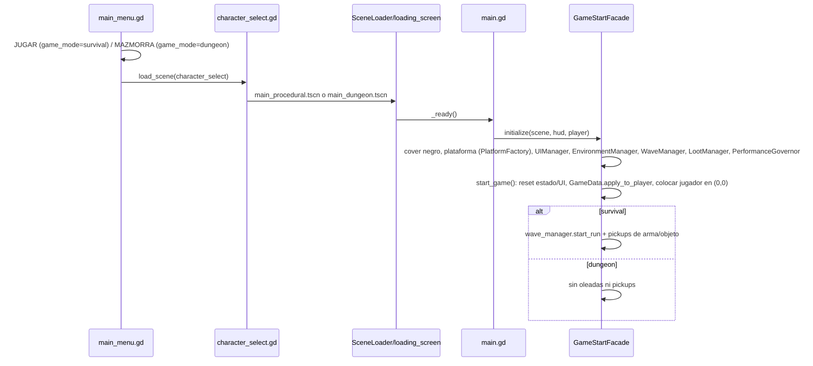
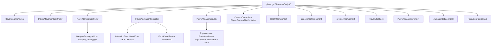
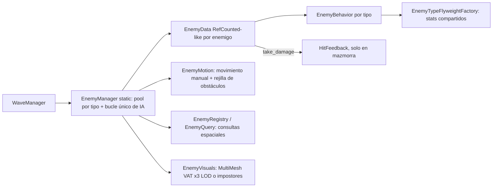

# CONTEXTO MAESTRO DEL JUEGO — RUMBANG

> Documento de referencia para una auditoría técnica, visual y de diseño independiente.
> Fecha de la inspección: 2026-10-26 · Rama: `developer` · Último commit: `095acd3`.
> Ruta: `CONTEXTO_MAESTRO_DEL_JUEGO.md` (raíz del proyecto).
>
> **Etiquetas de certeza**
> - `[VERIFICADO]`: comprobado leyendo código o recursos, o ejecutando el juego en esta sesión.
> - `[INFERIDO]`: deducción razonable a partir del código, sin prueba directa.
> - `[NO VERIFICADO]`: no se pudo comprobar.
>
> **Alcance real de la inspección**: `scripts/` (núcleo, entidades, componentes, objetos, UI, mundo), escenas principales, `project.godot`, `export_presets.cfg`, `resources/wave_config.json`, inventario de `assets/` (modelos, texturas, shaders, sonido), `docs/` (por títulos) y `SPEC_MEJORAS.md`. Los addons (`addons/godot_mcp_toolkit`, `addons/ziva_agent`, `addons/local_keep_ai`) **no** se auditaron: son herramientas de editor, no código de juego. No se leyeron línea a línea todos los ~19 000 líneas de GDScript; ver §Q.10.

---

## CONTEXTO RÁPIDO PARA OTRA IA

- **Qué es**: *RUMBANG* (también escrito RUNBANG en documentos antiguos) es un **roguelite de acción en tercera persona en 3D**, hecho en **Godot 4.7** con GDScript. Tiene **dos modos**:
  1. **Supervivencia** (modo original y el más completo): mapa abierto procedural "dark fantasy", hordas continuas de goblins que escalan con el tiempo, subida de nivel con cartas de mejora, objetos pasivos y un jefe (el **Nigromante**) a los 7:10. Si lo derrotas, ganas. Inspirado explícitamente en *Megabonk* (comentario en `scripts/world/procedural_map.gd`) y en el género *survivors*.
  2. **Mazmorra** (nuevo, en desarrollo en esta rama, sin commit): cuevas goblin procedurales al estilo *Soul Knight 3D* (lo pidió el usuario). Por ahora **solo se explora**: no aparecen enemigos, las oleadas están desactivadas en este modo. Se centra en el combate cuerpo a cuerpo de **Mikeura** con la *Espalanza*.
- **Personajes**: 9 jugables (Mikeura, Heckler, Vangry, Bronch, Tatan, Joel, Riva, Garri, Saimon). Cada uno tiene su arma inicial y algunos una pasiva. Son modelos de Mixamo con animaciones de idle, caminar, correr y saltar. **Solo Mikeura** tiene animaciones de ataque propias (hechas en esta sesión).
- **Combate**: patrón Strategy (`scripts/components/weapon_strategy.gd`), 11 armas. Por defecto **ataque automático** al enemigo más cercano (`AutoCombatController`). Ahora el click izquierdo también ataca, y con la Espalanza el click derecho mantenido carga un lanzamiento.
- **Enemigos**: 6 tipos de goblin con datos en un *Flyweight*. Se mueven con física manual (`EnemyMotion`) y se dibujan con **MultiMesh + VAT (Vertex Animation Textures) + LOD**, o con impostores en móvil. Solo tienen animaciones de idle y caminar: **no hay animaciones de ataque, golpe ni muerte**.
- **Objetivo de plataforma**: PC y **Android**. Hay un `export_presets.cfg` para Android y un `tesis.apk` en la raíz. Es un **proyecto de tesis/curso** (entregas de patrones de diseño en `docs/entrega3/`), lo que explica la cantidad de patrones GoF explícitos.
- **Estado**: jugable en supervivencia. En la rama `developer` hay mucho trabajo **sin commit**: modo mazmorra, animaciones, game feel, IK y destructibles.
- **Riesgo crítico**: `.gitignore` excluye **`assets/`** completa (modelos, texturas, sonidos, shaders), además de `*.import`, `*.uid` y `*.txt`. Los recursos visuales y de audio **no están versionados en git**.
- **Archivos para empezar**: `project.godot`, `scripts/core/game_start_facade.gd`, `scripts/core/main.gd`, `scripts/entities/player.gd`, `scripts/components/weapon_strategy.gd`, `scripts/core/wave_manager.gd`, `scripts/entities/enemy_data.gd`, `scripts/core/enemy_visuals.gd`, `scripts/world/procedural_map.gd`, `scripts/world/dungeon_map.gd`, `scripts/core/hit_feedback.gd`, `scripts/components/player_animation_controller.gd`.

---

## A. Resumen ejecutivo

| Campo | Valor | Certeza |
|---|---|---|
| Nombre | `config/name="Rumbang"` en `project.godot`; "RUNBANG" en `SPEC_MEJORAS.md` y `docs/resumen_runbang.txt` | [VERIFICADO] |
| Descripción oficial | "Roguelike 3D shooter and melee game in third person perspective built with Godot 4.3" (`project.godot`). La versión real es 4.7 | [VERIFICADO] |
| Motor | Godot 4.7 (`config/features=PackedStringArray("4.7", "Forward Plus")`). Probado en esta sesión con Godot 4.7.1-stable | [VERIFICADO] |
| Renderer configurado | `renderer/rendering_method="mobile"`, que **contradice** el feature tag "Forward Plus" y el README ("Forward Plus") | [VERIFICADO] |
| Plataformas | Windows (desarrollo) y Android (`export_presets.cfg`, preset "Android"; `tesis.apk` de 119 MB en la raíz) | [VERIFICADO] |
| Escena principal | `res://scenes/ui/main_menu.tscn` | [VERIFICADO] |
| Lenguaje | GDScript (unas 19 000 líneas en `scripts/`) | [VERIFICADO] |
| Contexto | Proyecto de tesis/curso universitario (UPC): entregas de patrones GoF y SOLID (`docs/entrega3/`, `Formato_Control_Cambios.md`, diagramas UML) | [VERIFICADO] |

### Bucle principal (supervivencia) [VERIFICADO]
Menú → elegir personaje → `main_procedural.tscn` → se genera el mapa → hordas continuas (`WaveManager`) → los enemigos sueltan XP y oro → al subir de nivel aparecen 3 cartas (arma nueva, mejora específica o genérica) → a los 430 s aparece el Nigromante (1000 HP, 3 fases) → victoria al matarlo, o derrota al morir. Se guardan el oro total y el mejor tiempo por personaje.

### Bucle del modo mazmorra (en desarrollo) [VERIFICADO]
Menú "MAZMORRA" → elegir personaje → `main_dungeon.tscn` → se generan 6–8 cavernas goblin → explorar, romper barriles y cajas, practicar el combo. **No hay enemigos, puertas, salida ni objetivo.**

### Fortalezas actuales
- Optimización del enjambre muy trabajada: MultiMesh + VAT + LOD por distancia, impostores en móvil, pools, rejilla espacial, topes de calidad y un banco de pruebas (`EnemyBenchmark`, `RUMBANG_BENCH`). [VERIFICADO en código]
- Arquitectura modular con componentes del jugador y patrones explícitos (Strategy, Facade, Flyweight, Builder, Factory, Adapter, Decorator, Singleton). [VERIFICADO]
- Mucha variedad de armas, con mecánicas distintas (ver §E). [VERIFICADO]
- Mapa procedural optimizado: un MultiMesh por tipo de prop y por chunk, colisiones de props como datos 2D para los enemigos. [VERIFICADO]
- Game feel de impacto y animaciones de ataque exageradas para Mikeura, recién añadidos. [VERIFICADO, solo en modo mazmorra]

### Debilidades identificadas
- Enemigos sin animaciones de ataque, impacto ni muerte (solo idle y caminar en VAT). El ataque cuerpo a cuerpo goblin es un temporizador de 0,4 s sin telegrafía visual. [VERIFICADO]
- Solo Mikeura tiene animaciones de ataque. Los otros 8 personajes atacan con VFX sin animación corporal, y los modelos de arma están **ocultos a propósito** salvo la Espalanza en mano (`player.gd:update_weapon_visuals`). [VERIFICADO]
- Sistemas a medio conectar: objetos recogibles que no abren la elección (§O-02), mejoras permanentes que se compran pero no se aplican (§O-03), jefe antiguo `boss.gd` sin uso. [VERIFICADO]
- El modo mazmorra no tiene enemigos ni objetivo, y el game feel (`HitFeedback`) solo se activa en ese modo, donde ahora no hay enemigos. [VERIFICADO]
- Assets fuera del control de versiones. [VERIFICADO]

### Principales incertidumbres
1. El rendimiento real en un Android físico con el renderer `mobile` no se midió en esta sesión. [NO VERIFICADO]
2. La calidad visual del modo supervivencia no se capturó en esta sesión (sí el modo mazmorra).
3. No está claro si el modo mazmorra sustituirá o complementará al modo supervivencia (decisión de producto abierta).
4. El balance real de armas y enemigos no se ha probado en partida completa.
5. El estado de los addons de IA (ziva_agent, godot_mcp_toolkit) y si afectan a la exportación.

---

## B. Identidad y dirección artística

| Aspecto | Estado actual | Certeza |
|---|---|---|
| Estilo | **Mezcla**: personajes y goblins de Mixamo/escaneo con texturas 4096² (realismo estilizado), y props low-poly *flat-shaded* (procedurales o hechos en Blender) con un color por material (`prop_flat.gdshader`) | [VERIFICADO] |
| Tono | "Dark fantasy" nocturno (`procedural_map.gd` cabecera; `WorldEnvironment` con cielo azul muy oscuro y niebla) | [VERIFICADO] |
| Fantasía | Héroes caricaturescos y absurdos (orco punk, druida, duende alquimista, zombi teletransportador, titán radiactivo) contra hordas goblin con jefe nigromante | [VERIFICADO por el lore en `game_data.gd`] |
| Folclore | Los objetos tienen nombres de folclore latinoamericano/colombiano (Mohán, Tumbaga, Ceiba, Ánima, Aguardiente, Poncho) en `scripts/core/item_db.gd` | [VERIFICADO] |
| Paleta mazmorra | Tierra marrón con musgo, roca violeta grisácea, acentos verde ácido (grietas de la Espalanza, ojos de tótems y calaveras), naranja de las fogatas | [VERIFICADO con capturas de la sesión] |
| Paleta supervivencia | Azules y violetas fríos, brasas naranjas, hongos luminosos | [INFERIDO del código del entorno] |
| Escala | Personaje ≈ 1,62 m (`PlayerAnimationController._fit_model`). Cavernas de 28–44 m. Mapa abierto de unos 230 m de lado | [VERIFICADO] |
| Legibilidad | El personaje oscuro (Mikeura) contrasta poco con el suelo oscuro de la cueva. El HUD tiene marco ornamentado metálico | [VERIFICADO con capturas] |
| Referencias explícitas | Megabonk (mapa), Soul Knight (modo mazmorra, petición del usuario). No hay *moodboard* en el repo | [VERIFICADO] |

**Inconsistencias**:
- Calidad desigual: personajes y goblins con texturas 4096² frente a props de pocos polígonos con color plano. Los muros de la cueva son cajas giradas que desde arriba se leen como bloques. [VERIFICADO con capturas]
- La lore de Mikeura habla de un **escudo** ("Guerrero del Escudo"), pero su arma es la **Espalanza** y su animación es de lancero. [VERIFICADO]
- Heckler reutiliza el modelo y la textura de Mikeura (`GameData.IDLE_MODELS`, `get_texture_path`). [VERIFICADO]
- No hay una dirección artística documentada formalmente: lo anterior se deduce del contenido.

---

## C. Arquitectura y mapa del código

### C.1 Árbol relevante
```
project.godot              Autoloads, input, render
scenes/
  ui/main_menu.tscn         Escena principal (menú; scripts/ui/main_menu.gd construye la UI por código)
  ui/character_select.tscn  Selección de personaje + vista previa 3D
  ui/loading_screen.tscn    Carga en segundo plano (SceneLoader)
  ui/hud.tscn, pause_menu.tscn, upgrade_choice_ui.tscn, item_choice_ui.tscn
  core/main_procedural.tscn Partida de supervivencia (Main + ProceduralMap + Player + HUD)
  core/main_dungeon.tscn    Partida de mazmorra (Main + DungeonMap llamado "ProceduralMap")
  entities/player.tscn, boss.tscn (antiguo, sin uso), necromancer_boss.tscn
  objects/*.tscn            Balas, hitboxes, proyectiles, pickups, orbes de XP
scripts/
  core/       Autoloads y gestores (game_data, save, audio, pool, quality, wave, enemy_*, hit_feedback, facade)
  entities/   player.gd, enemy_data.gd, enemy_behavior.gd, jefes, player_weapon_visuals.gd, player_weapons/
  components/ Componentes del jugador (input, movement, combat, animation, camera, stats, IK...) + weapon_strategy.gd
  objects/    Proyectiles, hitboxes, VFX, pickups, destructibles, espíritus animales
  world/      procedural_map.gd, dungeon_map.gd, grass_mesh.gd
  ui/         Menús, HUD, cartas, estilos
  patterns/   Implementaciones GoF de la entrega 3 (builder, factory_method, flyweight, prototype, adapter, decorator...)
assets/ (NO versionado)  models/, textures/, shaders/, sfx/, audio/, vat/, vfx/, BinbunVFX*/
resources/wave_config.json  Pools de enemigos por tiempo
tools/                    Horneado de VAT e impostores, LODs en Blender, generación de SFX
blender_sources/          (.gdignore) mikeura_anims.blend, fuente de las animaciones de ataque
docs/                     Planes de diseño y entregas académicas
graphify-out/             Grafo de conocimiento del código (ver AGENTS.md)
```

### C.2 Autoloads (`project.godot`) [VERIFICADO]
`GameData` (personajes, selección, modo de juego, cachés), `SaveManager` (`user://soul_knight_save.json`), `AudioManager` (SFX 2D/3D con pool y límite de voces), `ItemDB` (objetos pasivos), `SceneLoader` (carga vía `loading_screen`), `SettingsManager` (`user://settings.json`, volúmenes y calidad), `VirtualInput` (controles táctiles), `PoolManager` (balas, números flotantes), `MCPRuntimeServer` (addon de herramientas; se ejecuta en partida, ver §O-10).

### C.3 Flujo de arranque de una partida

Archivos: `scripts/core/main.gd`, `scripts/core/game_start_facade.gd` (patrón Facade). [VERIFICADO]

### C.4 Composición del jugador


### C.5 Enemigos (ECS ligero, sin nodos por enemigo para la IA)

`EnemyData` imita la interfaz de un nodo (`is_in_group`, `global_position`, `take_damage`) para encajar con el código de las armas. [VERIFICADO: `enemy_data.gd:120-130`]

### C.6 Patrones de diseño comprobados [VERIFICADO]
| Patrón | Dónde | Uso real |
|---|---|---|
| Strategy | `weapon_strategy.gd` | Una clase por arma; `PlayerCombatController._strategies[tipo].attack()` |
| Facade | `game_start_facade.gd` | Arranque y reinicio de la partida |
| Flyweight | `scripts/patterns/flyweight/` | Stats de los 6 tipos de enemigo |
| Builder + Director | `builder_pattern.gd`, `builder_director.gd` | Tabla de armas en `weapon_data.gd` |
| Prototype | `WeaponPrototypeRegistry`, `WeaponData.clone()` | Copia de la tabla de armas |
| Factory Method | `scripts/patterns/factory_method/` | `NecromancerBossCreator` (usado); `BossCreator` (no usado) |
| Abstract Factory | `PlatformFactory` (Mobile/Desktop) | Entorno, viewport, luz, controles táctiles, mapa |
| Adapter | `MovementSource` + adaptadores | Teclado, mando y táctil en `PlayerInputController` |
| Decorator | `DamageSource` + decoradores | `player._damage_chain` (berserk, etc.) |
| Singleton | `GameState.get_instance()` + autoloads | Estado de la sesión (tiempo, oro) |
| Object Pool | `PoolManager`, `EnemyManager`, `SlashVFX`, `HitFeedback` | Balas, enemigos, VFX |

### C.7 Comunicación
- Señales del jugador: `stats_changed`, `experience_gained`, `leveled_up`, `weapon_changed`, `weapon_attacked`, `reload_state_changed`, `player_died` (`player.gd`). [VERIFICADO]
- `weapon_attacked` lo escuchan el HUD (retroceso de la mira) y `PlayerAnimationController` (combo de Mikeura). [VERIFICADO]
- El daño a enemigos se hace por *duck typing* (`has_method("take_damage")`, `is_in_group("enemies")`). [VERIFICADO]
- `HitFeedback.weapon_tag` es una **variable estática global** que cada punto de impacto fija antes de `take_damage` (acoplamiento implícito, ver §O-07). [VERIFICADO]

### C.8 Acoplamientos y duplicaciones detectados
- `player_weapon_visuals.gd` (1057 líneas) construye por código los modelos de todas las armas, pero todos se ocultan; solo la Espalanza de mano se ve. [VERIFICADO]
- `weapon_strategy.gd` (1003 líneas) mezcla la lógica de daño con los VFX. [VERIFICADO]
- La carga de modelos y animaciones FBX está duplicada en `player_animation_controller.gd`, `necromancer_boss.gd` y `character_preview.gd` (funciones `_merge_first_animation_from_scene` y similares). [VERIFICADO por nombres de función]
- `procedural_map.gd` contiene la tabla `PROPS` con los props goblin del modo mazmorra, porque `DungeonMap` hereda de `ProceduralMap` y la constante no se puede sobrescribir. [VERIFICADO]
- `scripts/core/main_ready_god_method_ejemplo.gd` y `scripts/patterns/*_pattern.gd` son material didáctico mezclado con el código de juego (según `SPEC_MEJORAS.md` §3.3). [INFERIDO]

---

## D. Jugador, controles y movimiento

| Sistema | Implementación | Estado |
|---|---|---|
| Movimiento | `PlayerMovementController.handle_movement`: relativo a la cámara (SpringArm), velocidad = `move_speed × stat_block.move_mult × berserk 1.3 × polvo 1.35`, **sin aceleración** (velocidad instantánea). El modelo rota hacia la dirección de movimiento con `lerp_angle` 14/s | [VERIFICADO] |
| Correr | No hay botón. La animación "run" se usa si la velocidad supera `move_speed × 1.2` | [VERIFICADO] |
| Salto | Espacio o mando A, `BASE_JUMP_VELOCITY 8.5`, gravedad 22, saltos extra por objetos | [VERIFICADO] |
| Esquiva o rodar | `roll_speed = 18.0` exportado **sin uso**; el sonido `dodge.wav` existe y no se usa | [VERIFICADO: sin referencias] |
| Dash de ataque | `add_dash()` (nuevo): impulso que frena a 70 m/s² y reduce el control al 25 %. Lo disparan los ataques de Mikeura con retardo (estocada 17 m/s ≈ 2,3 m) | [VERIFICADO con medición] |
| Ataque | Automático (`AutoCombatController`, radio 15 m) + click izquierdo mantenido (`Input.is_action_pressed("attack")`, añadido en esta sesión) | [VERIFICADO] |
| Alterno (click derecho) | Polvos: cambia de modo. Espalanza: carga y lanzamiento (nuevo). Resto: `throw_spear()` → sin efecto | [VERIFICADO] |
| Habilidad E | Berserk 6 s (cooldown 50 %, daño y velocidad), con grito animado en Mikeura. Heckler se teletransporta. Cooldown 10 s | [VERIFICADO] |
| Recursos | `max_hp`, `max_shield` con regeneración tras un retardo, munición y recarga en algunas armas, XP y nivel | [VERIFICADO] |
| Muerte | `player_died` → efecto de escaneo con shader (`play_death_scan`). **No hay animación de muerte ni de recibir daño** | [VERIFICADO] |
| Cámara | Tercera persona con `SpringArm3D` y zoom entre 2,5 y 10 m, personaje centrado, retroceso por arma (`apply_camera_recoil`) y shake por impacto (`HitFeedback`, solo en mazmorra) | [VERIFICADO] |
| Teclas de depuración | T = enemigo de prueba, Y = orbes, O = jefe, F9 = banco de pruebas (`main.gd:_input`) | [VERIFICADO] |

---

## E. Combate, armas y habilidades

### E.1 Tabla de armas (`scripts/entities/player_weapons/weapon_data.gd`)
Valores **antes** del balance global `_apply_balance`, que multiplica el cooldown ×1,5 y el daño ×0,85 si el cooldown es ≥ 0,25 s, y la velocidad de proyectil ×0,65 (mínimo 8). [VERIFICADO]

| ID | Arma | Tipo | Daño | Cooldown | Alcance/vel. | Extra | Personaje inicial |
|---|---|---|---|---|---|---|---|
| 0 | Espada de Energía | melee | 12 | 0.45 | 3.2 m | cono 75° | — |
| 3 | Escopeta de Humo | ranged | 4 | 0.80 | vel 36 | 5 perdigones | Riva |
| 4 | Cañón Railgun | ranged | 45 | 1.50 | 50 m | hitscan | — |
| 5 | Espalanza de Mikeura | melee | 15 | 0.50 (×1.4 en la estrategia) | 5 m | cono 80°, hasta 8 hojas | Mikeura |
| 6 | Lanzallamas | melee continuo | 2 | 0.20 | 11 m | ráfaga y recalentamiento | Vangry |
| 7 | Bazuca de Esporas | ranged | 70 | 2.2 | 2.6 (área) / vel 10 | nubes de veneno, salvas de hasta 5 | Bronch |
| 10 | Polvos Alquímicos | special | — | — | — | 3 modos: área, velocidad, curación | Tatan |
| 11 | Espíritus de Joel | invocación | 14 | 1.6 | — | Komodo, búho, hipopótamo; sangrado | Joel |
| 12 | Hacha Giratoria | ranged | 9 | 1.0 | vel 20, 10 m | bumerán, hasta 5 | Garri |
| 13 | Ciclo Elemental | ranged | 7 | 0.6 | vel 22 | orbes que rotan elemento | Saimon |
| 14 | Brazo Bumerán | ranged | 18 | 0.8 | vel 20 | mejoras propias | Heckler |

- Mejoras por arma: `weapon_upgrades.gd` (`damage`, `size`, `quantity_bonus`, `lifesteal`, `cooldown`, con tope de cooldown ×0,3). [VERIFICADO]
- Estados alterados: `status_effects.gd` (veneno hasta 5 cargas, sangrado hasta 3 con +50 % si el objetivo se mueve, quemadura). [VERIFICADO]
- ¿Se sienten distintas? En el código, sí: cada estrategia tiene su mecánica propia (hitscan, cono, invocación, bumerán, nubes, ráfaga). [VERIFICADO] En pantalla no se comprobó, salvo la Espalanza.

### E.2 Espalanza de Mikeura (lo más trabajado en esta sesión) [VERIFICADO]
- **Golpe**: `SpearLanceStrategy.attack` → `_strike_blade` crea `spear_lance_hitbox.tscn` (`MeleeHitbox`, 0,35 s, empuje 16) **en el instante del clic**, mientras la animación golpea unos 0,2–0,4 s después (desincronía, ver §O-05). Con un `BladeTrail` en mano visible, el golpe principal usa la estela; las hojas extra usan `SLASH_VFX`.
- **Combo**: `PlayerAnimationController.play_attack()` alterna attack1 (estocada), attack2 (giro de 360°) y attack3 (salto y clavado). Se reinicia tras 1,1 s sin atacar.
- **Lanzamiento cargado** (click derecho mantenido): `PlayerCombatController.start_spear_charge`/`release_spear_charge` y `SpearLanceStrategy.throw_spear_charged(power)`:
  - Carga máxima en 1,1 s; daño 25→90, velocidad 34→70.
  - A carga completa atraviesa enemigos (`spear_projectile.gd`, `pierce`).
  - Mientras carga: postura sostenida, movimiento al 50 %, temblor del modelo de 0,006 a 0,035 m y aura (`spear_aura.gdshader`, partículas y luz).
- **Modelo**: `assets/models/weapons/espalanza.glb` (Blender, en esta sesión) con `obsidian_cracks.gdshader` (Voronoi 3D en espacio de objeto, sin UV). Va en un `BoneAttachment3D` sobre `mixamorig_RightHand`, con `GRIP_ROTATION = (0,0,-90)`.
- `SpearLanceStrategy.ENABLE_SPEAR_THROW = false` sigue desactivando el `throw_spear()` antiguo, sustituido por el cargado.

### E.3 Game feel de impacto — `scripts/core/hit_feedback.gd` [VERIFICADO]
- Solo se activa si `GameData.game_mode == "dungeon"`.
- Perfiles por arma (`PROFILES`):
  - Flash aditivo en el punto de impacto.
  - SFX propio, sintetizado: `impact_*.wav`, `kill_burst.wav`.
  - Partículas por tipo: chispa, esquirla, brasa, nube, orbe.
  - Knockback extra (`apply_knockback`).
  - Shake de cámara (`h_offset`/`v_offset`).
  - Hitstop con `Engine.time_scale = 0.04` (máx. 0,12 s), restaurado en tiempo real.
- Lo llama `EnemyData.take_damage` en los golpes que no son daño continuo. **El jefe Nigromante no lo llama.** [VERIFICADO: tiene su propio `take_damage`]

### E.4 Destructibles — `scripts/objects/destructible_prop.gd` [VERIFICADO]
Barriles (18 HP) y cajas (25 HP) del modo mazmorra. Grupo `destructibles`; se tambalean, se rompen con astillas, polvo y sonido. Los golpean `MeleeHitbox`, `bullet.gd` y `spear_projectile.gd`. **No** les afectan el hacha, las serpientes, los polvos ni las esporas.

---

## F. Enemigos, IA y jefes

### F.1 Tipos (`EnemyTypeFlyweightFactory._create`: hp, velocidad, rango, daño, oro, escala) [VERIFICADO]
| Tipo | HP | Vel | Rango | Daño | Oro | Escala | Comportamiento (`enemy_behavior.gd`) | Modelo/textura |
|---|---|---|---|---|---|---|---|---|
| GOBLIN_RANGED (mago) | 30 | 2.0 | 14 | 2 | 6 | 1 | Mantiene una distancia de 8–11,5 m y dispara cada 4,5 s | `idle_magoblin.fbx`, `textura_mago_goblin.png` |
| NORMAL_GOBLIN | 40 | 4.5 | 1.0 | 0.5 | 8 | 1 | Melee: persigue; 0,4 s de *windup* invisible y luego daño; cooldown 2 s | `idle_normal_goblin.fbx` |
| HEAVY_BRUTE | 90 | 2.0 | 1.4 | 0.5 | 15 | 1.5 | Melee; resistencia al knockback 0,3 | `idle_goblin_bruto.fbx` |
| SNIPER_GOBLIN | 45 | 2.3 | 9 | 6 | 20 | 1.1–1.25 | A distancia, cada 5,5 s | modelo de mago |
| ZOMBIE_GOBLIN | 25 | 1.5 | 1.2 | 1.0 | 3 | 0.9 | Melee; aparece en grupos de 3–5 | `goblin_idle_zombie.fbx` |
| MORTAR_GOBLIN | 35 | 1.8 | 30 | 5 | 14 | 1.05–1.1 | Mortero parabólico (`MortarShell`) entre 10 y 30 m, cada 6,5 s | modelo de mago |

- Separación global de 400 ms entre disparos de cualquier enemigo (`try_global_shot`). [VERIFICADO]
- Movimiento: `EnemyMotion`, integración manual y resolución contra el relieve, los props (rejilla) y el jugador. **No hay navegación por pathfinding.** Persiguen en línea recta. [VERIFICADO]
- **Animaciones**: solo idle y caminar horneadas en VAT. No hay ataque, impacto (solo un destello de shader), muerte (el enemigo se recicla al instante) ni telegrafía. [VERIFICADO]
- En el modo mazmorra no aparecen enemigos. Las paredes sí se exponen en `get_colliders()` como cajas, para cuando los haya. [VERIFICADO]

### F.2 Oleadas — `scripts/core/wave_manager.gd` [VERIFICADO]
- Aparición continua; el intervalo baja de 1,4 a 0,25 s y el lote sube de 1 a 6.
- Topes de vivos según la calidad (`Quality.alive_cap_end`).
- Escalado: +15 % de HP y +6 % de daño por minuto.
- Pools por etapa en `resources/wave_config.json` (claves `default` y `stages` con `from` en segundos).
- Aparición dentro de ±95 m.
- Jefe a los **430 s** (7:10). Mientras vive, la aparición normal baja al 35 %.

### F.3 Nigromante — `scripts/entities/necromancer_boss.gd` (593 líneas) [VERIFICADO]
- 1000 HP, 500 de oro.
- 3 fases con cortes en 66 % y 33 %. Escalado por fase: velocidad ×1 / 1,35 / 1,7 y cooldown ×1 / 0,75 / 0,5.
- Habilidades en "bolsa barajada": invocar zombis (3/4/5), erupciones (4/6/8) y robo de vida con haz (3–4,5 s, rango 15–20, 2–3 de daño).
- Queda vulnerable 1,2 s tras cada habilidad.
- Barra de vida con marcas de fase y tinte por fase.
- Animaciones FBX: caminar, ataque/idle, invocar zombis e invocar erupciones.
- **No hay animación de muerte** [INFERIDO por los nombres de archivo; `_die()` no se leyó completo].

### F.4 Jefe antiguo — `scripts/entities/boss.gd` + `boss.tscn`
600 HP, anillo de balas y 2 fases. Solo lo referencia `BossCreator`, que **nadie instancia**: está en el repo pero no se usa. [VERIFICADO por grep]

---

## G. Auditoría del sistema de animaciones

### G.1 Personajes jugables (`GameData.ANIM_FILES`) [VERIFICADO]
| Personaje | Clips | Notas |
|---|---|---|
| mikeura | idle, walk, run, jump, **attack1, attack2, attack3, shout** | Ataques y grito creados en Blender en esta sesión (`blender_sources/mikeura_anims.blend`) |
| joel, bronch, garri, saimon, vangry | idle, walk, run, jump | Mixamo; vangry usa `Jumping.fbx` |
| riva | + fast (súper carrera) | |
| tatan | idle, walk, run (**sin salto**) | |
| heckler | usa los archivos de Mikeura | Sin modelo propio |

### G.2 Controlador — `scripts/components/player_animation_controller.gd` [VERIFICADO]
- Carga el FBX de idle como modelo y **fusiona** el primer clip de cada FBX en una `AnimationLibrary`. Reapunta las pistas a la ruta del esqueleto del modelo idle (`_retarget_tracks`), porque los FBX exportados desde Blender cuelgan de `Armature/Skeleton3D`.
- Árbol: `BlendTree` → `sm` (StateMachine idle/walk/run/fast/jump; el salto usa `TimeSeek` a 12/30 s o 32/30 s según el personaje) → `OneShot "shot"` (fade 0,08/0,18) ← `TimeSeek "seek"` ← `AnimationNodeAnimation "action"`. Su `animation` se cambia en tiempo de ejecución para el combo, el grito, la carga y el lanzamiento.
- `charge` es un clip derivado de attack1, recortado en 0,2 s y sostenido 30 s (`_make_hold_pose`).
- Transiciones: cambio inmediato con fundidos de 0,1–0,15 s. **No hay root motion.** El desplazamiento real lo da el dash por código.
- **IK de pies**: `scripts/components/foot_ik_modifier.gd` (`SkeletonModifier3D`) hace IK analítico de 2 huesos por pierna. Evita que el pie atraviese el suelo, sigue la altura del terreno bajo cada pie, ajusta la cadera y se apaga en el aire. Medido: en el clavado el pie más bajo baja a -0,066 m sin IK y se queda a 0,088 m con IK. **No hay IK de manos** (la mano izquierda no agarra la lanza).
- **Problema de importación resuelto**: un `.blend` dentro de `assets/` hacía fallar `--import` en modo headless (Godot intentaba usar Blender). Se movió a `blender_sources/` con `.gdignore`. Los `.import` de los 4 FBX de Mikeura tienen además `optimizer/enabled=false`.

### G.3 Enemigos y jefe
- Goblins: VAT horneado (`tools/bake_enemy_vat.gd`, `assets/vat/*.res`) con idle y walk, 3 LOD, y transición por fase de VAT. [VERIFICADO]
- Nigromante: AnimationTree propio con 4 clips (§F.3). [VERIFICADO]

### G.4 Problemas observados
- Los otros 8 personajes atacan sin animación corporal. [VERIFICADO]
- No hay animaciones de recibir daño, muerte, esquiva ni aterrizaje. [VERIFICADO]
- Las animaciones de Mikeura son poses clave con interpolación automática de Blender, sin curvas de *ease* ajustadas a mano ni *smear frames*. La mano izquierda flota. [VERIFICADO visualmente]
- Posible deslizamiento de pies al caminar con velocidades modificadas por objetos (la animación no escala con la velocidad). [INFERIDO; no hay `speed_scale` en el controlador]
- Durante el giro de 360° de attack2, la dirección del modelo (`player.mesh`) no cambia: solo gira la cadera en la animación. [VERIFICADO por diseño]

---

## H. Entornos, escenarios y diseño de niveles

### H.1 Mapa de supervivencia — `scripts/world/procedural_map.gd` (833 líneas) [VERIFICADO]
- Malla de terreno con ruido (colinas), plaza plana de inicio, acantilados que cierran la arena (`play_half = 98`) y una cuenca hundida ("cripta") con rampa, altar, pilares y brasas.
- Props `.glb` en `assets/models/mapa/`: árboles muertos, tumbas, ruinas, barriles, cajas, rocas, hongos y huesos.
- Un MultiMesh por tipo y por chunk; malla de cada prop "aplanada" a una superficie con color de vértice (`_flatten_mesh` + `prop_flat.gdshader`).
- Colisión de props como `StaticBody3D` y como datos 2D (`get_colliders`) para `EnemyMotion`.
- Luces de brasero limitadas (`max_lights`) y apagadas por distancia. En móvil: chunk único, celdas más grandes, menos densidad.
- Más contexto en `docs/MAPA_PROCEDURAL.md`.

### H.2 Mazmorra — `scripts/world/dungeon_map.gd` (549 líneas, hereda de `ProceduralMap`) [VERIFICADO]
- 6–8 cavernas en una rejilla de huecos (`SLOT = 26` celdas de 2 m), con conexiones en árbol más un 15 % de bucles. Inicio en el origen; la final es la más lejana por BFS.
- Forma de caverna: unión de 3–5 elipses con el borde deformado por ruido. Túneles serpenteantes de unos 6 m.
- Suelo: MultiMesh de planos de 2 m con color por celda (tierra/musgo). Paredes: MultiMesh de cajas rotadas en 2 anillos (el exterior más alto y sin colisión); colisión con cajas fusionadas por filas.
- Temas por caverna: campamento, almacén, santuario, inicio y final (altar, tótems, postes, braseros). Estalagmitas, huesos, hongos, rocas y pasto procedural (`GrassMesh` + `grass_wind.gdshader`).
- Medición de una generación: 8 cavernas, 2260 celdas, 216 props y 36–40 destructibles.
- **Falta**: enemigos, puertas que se cierran al entrar en una sala, salida o portal, cofres, minimapa y progresión entre pisos.

### H.3 Assets de entorno creados en esta sesión (Blender) [VERIFICADO]
`goblin_hut`, `goblin_totem`, `goblin_palisade`, `goblin_skull_pole`, `goblin_campfire`, `goblin_tent`, `cave_stalagmite` (`assets/models/mapa/*.glb`). Son de pocos polígonos, con color por material y emisión verde u naranja.

---

## I. Texturas, materiales, modelos y assets

| Recurso | Ruta | Formato/resolución | Uso | Estado |
|---|---|---|---|---|
| Texturas de personaje | `assets/textures/entities/<id>/texture_<id>.png` | PNG 4096², 13–20 MB cada una; importada con `size_limit` **2048** (Mikeura) | `PlayerAnimationController._apply_texture_to_meshes` (material sin sombreado especial, `CULL_DISABLED`) | En uso [VERIFICADO] |
| `texture_mikeura.jpg` | idem | JPG 2048² | **Sin referencia** | Sin uso [VERIFICADO por grep] |
| Texturas de goblin y jefe | `assets/textures/enemigos/*.png` | PNG 4096², 13–18 MB; `size_limit` **1024**, VRAM comprimida | VAT e impostores, Nigromante | En uso [VERIFICADO] |
| `arena.jpg`, `pasto.jpg`, `roca.jpg` | `assets/textures/entorno/` | JPG 2048² | **Sin referencias** en scripts ni escenas | Sin uso [VERIFICADO] |
| Modelos de personaje | `assets/models/<id>/*.fbx` | FBX Mixamo, uno por clip (cada FBX repite la malla) | Personaje | En uso |
| Modelos de enemigo | `assets/models/entities/enemigos/goblins/*.fbx` | FBX idle/walk | Fuente del VAT | En uso |
| VAT, LOD e impostores | `assets/vat/*.res, *_impostor.png/json` | Recursos horneados | `EnemyVisuals` | En uso |
| Props de mapa | `assets/models/mapa/*.glb` | GLB low-poly | Mapas | En uso |
| Armas | `assets/models/weapons/` (`espalanza.glb`, `axe_guitar.glb`, `human_arm_bones.glb`) | GLB | Espalanza (mano y lanzamiento); el resto [NO VERIFICADO] | |
| Espíritus | `assets/models/spirits/{hippo,komodo,owl}.glb` | GLB | Armas de Joel | En uso [INFERIDO] |
| Packs VFX | `assets/BinbunVFX*/`, `assets/vfx/` | Terceros | `flame_stream.gd` referencia BinbunVFX; el resto [NO VERIFICADO] | |

**Observaciones**:
- Los PNG de 4096² (unos 250 MB en total) se reducen al importar, así que en juego no se usan a resolución completa. [VERIFICADO por `.import`]
- No hay mapas normal, roughness ni metallic para personajes y enemigos: un único albedo. [VERIFICADO por el inventario]
- Los props usan color plano por material. [VERIFICADO]

---

## J. Iluminación, gráficos, atmósfera y efectos visuales

- **Renderer**: `mobile` (ver la contradicción en §A). Shader global `vfx_quality` (0–2). [VERIFICADO]
- **Entorno de escena** (`main_procedural.tscn`): cielo procedural muy oscuro, luz ambiental del cielo con energía 1,9, tonemap 2 (Filmic), *glow*, niebla de densidad 0,006 y ajustes de contraste y saturación. Luz direccional azulada con sombras (80 m). `main_dungeon.tscn` es una copia con ambiente 0,55, luz 0,45 y niebla 0,02. [VERIFICADO]
- **Calidad** (`scripts/core/quality.gd`): niveles Bajo, Medio y Alto. Android empieza en Medio y PC en Alto. Afecta a partículas, luces dinámicas, sombras, escala de resolución 3D (con `PerformanceGovernor` dinámico), tope de enemigos y luz por bala solo en Alto. Impostores por defecto en móvil (`RUMBANG_IMPOSTORS`). [VERIFICADO]
- **Shaders propios** (`assets/shaders/`):
  - Ataques: `slash_2_optimized`, `spear_thrust`, `spear_slash`, `sword_slash`, `ribbon_mesh`, `shotgun_distortion`, `alchemical_clouds`, `spore_fbm_cloud`, `orbe_elemental`, `spirit`, `necro_beam`.
  - Entidades: `enemy_vat`, `enemy_impostor`, `dissolve_spawn`, `depth_scan_spawn`.
  - Entorno: `dark_ground`, `prop_flat`, `grass_wind`.
  - Nuevos: `obsidian_cracks`, `blade_trail`, `spear_aura`.
  - `particle_ribbon_trail` no tiene referencias (según `SPEC_MEJORAS.md`; no se volvió a verificar).
- **Postprocesado**: solo lo que da `Environment` (glow, ajustes, tonemap). No hay SSAO, SSR ni SDFGI con el renderer `mobile`. [INFERIDO de la configuración]
- **Lo que vi en las capturas de esta sesión (modo mazmorra)**: la cueva se ve oscura y azulada, las paredes como bloques, los ataques con estela verde aditiva y el aura de carga potente. **El modo supervivencia no se capturó.**

---

## K. Audio, interfaz y experiencia de usuario

- **Música**: `assets/audio/main-soundtrack.mp3`, una sola pista (`UIManager.start_music`). [VERIFICADO]
- **SFX**: unos 22 en `assets/sfx/`. Algunos se generan por código (`tools/generate_sfx.gd`) y los 7 `impact_*`/`kill_burst` se sintetizaron con numpy en esta sesión. `AudioManager` tiene un pool 3D de 16, máximo 4 voces por SFX y 40 ms entre repeticiones. Hay buses Master, SFX y Music con sliders. [VERIFICADO]
- **HUD** (`scenes/ui/hud.tscn` + `hud.gd`): HP y escudo, XP, 5 ranuras de arma, recarga, tiempo, oro, contador de FPS, confeti al subir de nivel y retroceso de la mira. [VERIFICADO]
- **Menús**: principal (Jugar, Mazmorra, Mejoras, Opciones, Salir), selección de personaje con vista previa 3D, pausa con estadísticas, ajustes (calidad y volúmenes), cartas de subida de nivel (3 cartas) y elección de objeto (2). Estilo con tema pixel (`themes/pixel_theme.tres`) y `rumbang_style.gd`. [VERIFICADO]
- **Controles**: teclado y ratón, mando (adaptadores) y táctil (`mobile_controls.gd`, `VirtualInput`). [VERIFICADO]
- **No se verificó**: accesibilidad (no hay opciones de remapeo, tamaño de texto ni daltonismo), ni el escalado del HUD en pantallas de móvil de distintas proporciones.

---

## L. Progresión, economía y sistemas secundarios

| Sistema | Estado | Evidencia |
|---|---|---|
| XP y nivel | Conectado: orbes (`xp_orb.gd`, tope 90 en el suelo) → `ExperienceComponent` → cartas | [VERIFICADO] |
| Cartas de mejora | Conectado (`upgrade_choice_ui.gd`): arma nueva (4 ranuras), mejora específica o genérica | [VERIFICADO] |
| Objetos pasivos | 18 objetos con rareza (`item_db.gd`). Se aplican en `PlayerStatBlock` | [VERIFICADO] |
| Pickup de objeto | **Roto**: `item_pickup.gd` llama a `current_scene.show_item_choice()`, pero `main.gd` no tiene ese método (está en `UIManager`). El pickup desaparece sin abrir la elección | [VERIFICADO por grep] |
| Oro | Por enemigo (multiplicado por el objeto "Duende"); se suma al total guardado | [VERIFICADO] |
| Mejoras permanentes (menú) | Se compran con oro (`SaveManager.buy_upgrade`), pero **ningún sistema de partida lee `get_upgrade`** | [VERIFICADO por grep] |
| Guardado | `user://soul_knight_save.json`: oro total, mejoras compradas, "best_floors" (que en realidad guarda el mejor tiempo en segundos) | [VERIFICADO] |
| Victoria y derrota | Victoria al matar al Nigromante. Derrota a 0 HP. Reinicio desde el HUD (`restart_pressed`) | [VERIFICADO] |
| Modo mazmorra | Sin progresión, objetivo ni condición de fin | [VERIFICADO] |

---

## M. Rendimiento, estabilidad y calidad técnica

### M.1 Medido
- En esta sesión, en PC con Godot 4.7.1 y capturas a 800–1280 px, el contador del HUD marcó **60 FPS** en el modo mazmorra sin enemigos. No es representativo de un combate. [VERIFICADO]
- Según comentarios del código (`quality.gd`), 300 enemigos cuestan unos 13 ms de física por tick en PC (banco `RUMBANG_BENCH`). [VERIFICADO como afirmación del código; no se repitió la medición]

### M.2 Riesgos técnicos en el código
- `HitFeedback` usa `Engine.time_scale` global. Cualquier otro sistema que lo modifique entraría en conflicto. Se restaura en `_exit_tree`. [VERIFICADO]
- Los destructibles son un `StaticBody3D` y un `MeshInstance3D` cada uno (unos 40 nodos y 40 llamadas de dibujo en la mazmorra). [VERIFICADO]
- `DestructibleProp._spawn_debris` y `HitFeedback` crean partículas: el primero con `new()` en cada rotura, el segundo con pool. [VERIFICADO]
- Las luces dinámicas de los VFX están limitadas por `Quality`; las de la mazmorra, por `max_lights`. [VERIFICADO]
- `player_weapon_visuals.gd` construye los modelos de las 11 armas al iniciar, aunque no se muestren. [VERIFICADO]

### M.3 Hipótesis que requieren perfilado
- Coste de los shaders con fBm en móvil (`alchemical_clouds`, `spore_fbm_cloud`, `orbe_elemental`), ya señalado en `SPEC_MEJORAS.md` §2.2. [NO VERIFICADO en dispositivo]
- Coste del IK de pies, que consulta `get_first_node_in_group("procedural_map")` por pie y por frame. [INFERIDO bajo, NO MEDIDO]

### M.4 Errores y advertencias conocidos
- Advertencias de UID inválidos en varias `.tscn` (`radiation_zone`, `bullet`, `weapon_pickup`, `spear_projectile`, `spore_*`, `dust_projectile`, `main_menu`): `.uid` está en `.gitignore` y se regeneran. [VERIFICADO en la salida del motor y en `run_log.txt`]
- El error en tiempo de ejecución `throw_spear` inexistente en `PlayerCombatController` se corrigió en esta sesión. [VERIFICADO]
- Al salir del modo headless aparece "1 resources still in use at exit". [VERIFICADO, impacto desconocido]

---

## N. Estado de implementación

| Sistema | Estado | Evidencia | Dependencias | Pendiente |
|---|---|---|---|---|
| Menú, selección y carga | Implementado y conectado | `main_menu.gd`, `character_select.gd`, `scene_loader.gd` | GameData | — |
| Supervivencia (hordas + jefe) | Implementado y conectado | `wave_manager.gd`, `necromancer_boss.gd` | EnemyManager, Visuals | Probar balance |
| Modo mazmorra (generación) | Implementado parcialmente | `dungeon_map.gd`, `main_dungeon.tscn` | ProceduralMap | Enemigos, puertas, salida, pisos |
| 9 personajes y pasivas | Implementado (Tatan, Joel, Saimon sin pasiva; Garri con texto pero sin script) | `game_data.gd:apply_to_player` | — | Pasivas faltantes |
| 11 armas (Strategy) | Implementado y conectado | `weapon_strategy.gd` | VFX, hitboxes | Probar el feel de cada una |
| Ataque automático | Implementado y conectado | `auto_combat_controller.gd` | — | ¿Opción para desactivarlo? |
| Ataque con click | Implementado y conectado (sesión) | `player_input_controller.gd` | — | — |
| Lanzamiento cargado de la Espalanza | Implementado y conectado (sesión) | `player_combat_controller.gd`, `spear_projectile.gd` | Animación | — |
| Animaciones de ataque de Mikeura | Implementado y conectado (sesión) | `player_animation_controller.gd` | FBX | Mano izquierda, sincronía con la hitbox |
| IK de pies | Implementado y conectado (sesión) | `foot_ik_modifier.gd` | Skeleton3D | IK de mano |
| Dash de ataque | Implementado y conectado (sesión) | `add_dash` | Movement | — |
| Esquiva o rodar | Pendiente (solo la variable `roll_speed`) | `player.gd` | — | Todo |
| Game feel (`HitFeedback`) | Implementado; **solo en mazmorra**, que no tiene enemigos | `hit_feedback.gd` | EnemyData | Aplicar al jefe y a supervivencia |
| Destructibles | Implementado (mazmorra) | `destructible_prop.gd` | Hitboxes | Botín, más armas |
| Animaciones de enemigos (ataque, muerte) | Pendiente | VAT solo con idle y walk | Horneado VAT | — |
| Jefe antiguo `boss.gd` | Existe pero no está integrado | grep `BossCreator.new` = 0 | — | ¿Borrar? |
| Pickup de objeto → elección | Roto | §L | UIManager | Corregir la llamada |
| Mejoras permanentes | Placeholder: se compran y no se aplican | §L | SaveManager | Aplicar en partida |
| Guardado | Implementado | `save_manager.gd` | — | Renombrar `best_floors` |
| Calidad gráfica y gobernador | Implementado y conectado | `quality.gd`, `performance_governor.gd` | — | Validar en dispositivo |
| Controles táctiles | Implementado [NO VERIFICADO en dispositivo] | `mobile_controls.gd` | VirtualInput | — |

---

## O. Problemas, contradicciones y riesgos

| ID | Área | Descripción | Evidencia | Consecuencia | Gravedad | Certeza | Cómo comprobarlo |
|---|---|---|---|---|---|---|---|
| O-01 | Repo | `assets/` está en `.gitignore`: modelos, texturas, shaders, SFX, VAT y GLB nuevos fuera de git. También `*.import`, `*.uid` y `*.txt` | `.gitignore` | Pérdida irrecuperable de recursos; un clon no funciona | **Crítica** | Verificado | `git check-ignore -v assets/shaders/obsidian_cracks.gdshader` |
| O-02 | Progresión | El pickup de objeto llama a `show_item_choice` en la escena, que no lo implementa | `item_pickup.gd:19`, `main.gd` sin método | Los objetos del suelo desaparecen sin efecto | Alta | Verificado | Recoger un objeto en supervivencia |
| O-03 | Economía | Las mejoras del menú se compran pero no se aplican | `SaveManager.get_upgrade` solo en `main_menu.gd` | El oro gastado no aporta nada | Alta | Verificado | grep `get_upgrade` |
| O-04 | Render | `rendering_method="mobile"` frente a "Forward Plus" en features y docs | `project.godot` | Efectos y pruebas basados en supuestos erróneos | Media | Verificado | Abrir Project Settings |
| O-05 | Combate | La hitbox de la Espalanza nace en el instante del clic; el golpe animado llega 0,15–0,4 s después y el dash desplaza al jugador fuera de la hitbox | `weapon_strategy.gd:_strike_blade`, `ATTACK_DASH` | Golpes que no conectan con lo que se ve | Media | Verificado en código; impacto jugable no medido | Grabar un golpe junto a un enemigo |
| O-06 | Modo mazmorra | Sin enemigos, así que `HitFeedback` no tiene uso real salvo con las teclas de depuración T y O | `game_start_facade.gd` | El game feel no se puede evaluar en el modo previsto | Alta | Verificado | Jugar el modo |
| O-07 | Arquitectura | `HitFeedback.weapon_tag` es estático y lo fija cada punto de impacto. Si alguno lo omite, se hereda el arma del golpe anterior (el daño de estado no lo fija) | `hit_feedback.gd`, 11 puntos de llamada | Partículas o sonidos del arma equivocada | Baja | Verificado | Buscar `take_damage(` sin etiqueta |
| O-08 | Combate | El Nigromante no usa `HitFeedback` (su `take_damage` es propio) | `necromancer_boss.gd:508` | Los golpes al jefe se sienten más pobres | Media | Verificado | — |
| O-09 | Animación | Los enemigos no tienen animaciones de ataque, golpe ni muerte; el ataque cuerpo a cuerpo no se telegrafía | `enemy_behavior.gd:MeleeGoblinBehavior` | Combate difícil de leer | Alta | Verificado | — |
| O-10 | Build | El autoload `MCPRuntimeServer` (addon de herramientas) abre un puerto TCP local en partida | `project.godot` [autoload], log "listening on 127.0.0.1:6570" | Riesgo en builds de release y móvil | Media | Verificado (log) | Revisar la exportación |
| O-11 | Contenido | `boss.gd`/`boss.tscn` y `BossCreator` no se usan | grep | Código muerto | Baja | Verificado | — |
| O-12 | Datos | `best_floors` guarda segundos; el nombre engaña | `main.gd:86` | Confusión al ampliar | Baja | Verificado | — |
| O-13 | Visual | Los modelos de arma de los demás personajes se construyen pero se ocultan siempre por decisión del usuario | `player.gd:update_weapon_visuals` | Coste sin uso visual | Baja | Verificado | — |
| O-14 | Repo | `README.md` empieza documentando otro addon (Local Keep AI) | `README.md` | Confunde a nuevos lectores | Baja | Verificado | — |
| O-15 | Movimiento | No hay aceleración ni deceleración (la velocidad cambia de golpe) | `player_movement_controller.gd` | Movimiento "rígido" | Media | Verificado | — |
| O-16 | Destructibles | Los enemigos los atraviesan: no están en `get_colliders` | `dungeon_map.gd:get_colliders` | Incoherencia cuando haya enemigos | Media | Verificado | — |
| O-17 | Lore | Mikeura se describe como "Guerrero del Escudo" pero usa la Espalanza | `game_data.gd` | Incoherencia narrativa | Baja | Verificado | — |
| O-18 | Assets | Recursos sin uso: `texture_mikeura.jpg`, `arena/pasto/roca.jpg`, `particle_ribbon_trail.gdshader`, `dodge.wav` | grep | Peso en la build | Baja | Verificado (grep en scripts, escenas y recursos) | — |

---

## P. Decisiones de diseño y contexto histórico

**Confirmadas (por petición del usuario en esta sesión o por comentarios en el código)**:
- Modo mazmorra estilo Soul Knight 3D con mazmorras "no tan grandes", que después se ampliaron a cavernas tipo cueva goblin con formas no cuadradas. Barriles y cajas destruibles.
- Mikeura con 3 ataques de lanza y un grito. El usuario pidió **exagerar** ("no quiero realismo, quiero locura").
- Espalanza negra con grietas verdes y estela que sigue la hoja.
- Game feel en 5 pasos: flash, sonido, partículas por arma, knockback, shake + freeze. Limitado al modo mazmorra para no congelar las hordas.
- Click izquierdo para atacar; click derecho mantenido para cargar y lanzar con temblor y aura.
- "Ningún modelo de arma visible al atacar, solo el efecto" (comentario en `player.gd`); se hizo una excepción para la Espalanza en mano.
- Patrones GoF explícitos como requisito académico (`docs/entrega3/`): conviene preservarlos.
- Optimización móvil prioritaria (VAT, impostores, pools, calidad), según `docs/PLAN_OPTIMIZACION*.md`.
- Balance global: cooldown ×1,5, daño ×0,85 y proyectiles ×0,65 (`weapon_data.gd:_apply_balance`).

**Convenciones**:
- Comentarios y nombres en español. Componentes como nodos hijos del jugador. Datos de armas con Builder y Director.
- Regenerar el grafo con `python graphify-out/build_graph.py` tras cambios grandes (AGENTS.md).
- Las animaciones nuevas se editan en `blender_sources/mikeura_anims.blend` (escena `Mikeura_Anims`, texto `anim_lib` con helpers `apply_pose`, `aim_spear` y `make_action2`) y se exportan como FBX. **No guardar `.blend` dentro de `assets/`.**

**Sin resolver**:
- Relación final entre los modos supervivencia y mazmorra.
- Qué hacer con los modelos de arma ocultos y si los demás personajes tendrán animaciones de ataque.
- Pasivas pendientes de Tatan, Joel, Saimon y Garri.
- Si el ataque automático debe existir en el modo mazmorra.

**Cambios recientes sin commit** (`git status`): unos 25 scripts modificados y nuevos (mazmorra, HitFeedback, IK, destructibles, BladeTrail, dash, carga), `scenes/core/main_dungeon.tscn`, `blender_sources/` y `addons/ziva_agent/` (sin seguimiento).

---

## Q. Preparación para la auditoría independiente

1. **Qué hace el juego**: un roguelite de hordas en 3D completo hasta el jefe (supervivencia) y un prototipo de mazmorra-cueva explorable con combate de Mikeura pulido pero sin enemigos.
2. **Terminado y no terminado**: ver §N.
3. **Sistemas clave**:
   - Jugador: `scripts/entities/player.gd` y `scripts/components/*`.
   - Armas: `weapon_strategy.gd` y `weapon_data.gd`.
   - Enemigos: `enemy_manager.gd`, `enemy_data.gd`, `enemy_behavior.gd`, `enemy_motion.gd`, `enemy_visuals.gd`.
   - Oleadas: `wave_manager.gd`.
   - Mapas: `procedural_map.gd` y `dungeon_map.gd`.
   - Game feel: `hit_feedback.gd`.
4. **Qué leer antes de modificar cada cosa**:
   - Combate: `player_combat_controller.gd`, `weapon_strategy.gd`, `melee_hitbox.gd`, `hit_feedback.gd`.
   - Animación: `player_animation_controller.gd`, `foot_ik_modifier.gd`, `game_data.gd:ANIM_FILES`.
   - Enemigos: los archivos de enemigos más `quality.gd`.
   - Mapa: `procedural_map.gd` (la tabla `PROPS` es compartida).
5. **Limitaciones conocidas**: §O.
6. **Requieren pruebas**: rendimiento en Android (renderer `mobile`), balance de armas, el feel de cada arma en pantalla, la sincronía hitbox–animación y los controles táctiles.
7. **Inspección visual pendiente**:
   - Modo supervivencia completo: mapa, hordas, VAT, impostores y jefe.
   - Los VFX de las 10 armas restantes.
   - La vista previa de personajes.
   - El HUD en resolución de móvil.
8. **Cambios con efectos colaterales**:
   - `Engine.time_scale` (`HitFeedback`).
   - La tabla `PROPS` compartida.
   - La interfaz de *duck typing* de `EnemyData`.
   - El orden de nodos del `AnimationTree` (rutas `parameters/sm/...`).
   - `_apply_balance`, que afecta a todas las armas.
   - Las rutas del esqueleto en `_retarget_tracks`.
9. **Confirmado frente a provisional**: §P.
10. **Información que falta**:
    - No se leyeron en detalle: `necromancer_boss.gd` (completo), `elemental_orbs.gd`, `dust_projectile.gd`, `flame_stream.gd`, `character_select.gd`/`character_preview.gd`, `mobile_controls.gd`, `enemy_visuals.gd` (completo), `tools/*`, ni los addons.
    - No hay métricas de dispositivo.
    - No se verificó si `tesis.apk` corresponde al código actual.

### Orden de lectura recomendado
1. `AGENTS.md`, `graphify-out/GRAPH_REPORT.md`
2. `project.godot`
3. `scripts/core/game_start_facade.gd`, `scripts/core/main.gd`
4. `scripts/entities/player.gd`, `scripts/components/player_combat_controller.gd`, `scripts/components/weapon_strategy.gd`
5. `scripts/components/player_animation_controller.gd`, `scripts/components/foot_ik_modifier.gd`
6. `scripts/core/wave_manager.gd`, `scripts/core/enemy_manager.gd`, `scripts/entities/enemy_data.gd`, `scripts/entities/enemy_behavior.gd`
7. `scripts/core/enemy_visuals.gd`, `scripts/core/quality.gd`
8. `scripts/world/procedural_map.gd`, `scripts/world/dungeon_map.gd`
9. `scripts/core/hit_feedback.gd`, `scripts/objects/destructible_prop.gd`
10. `scripts/entities/necromancer_boss.gd`
11. `SPEC_MEJORAS.md`, `docs/PLAN_*.md`, `docs/entrega3/02_informe_incorporacion_patrones.md`
