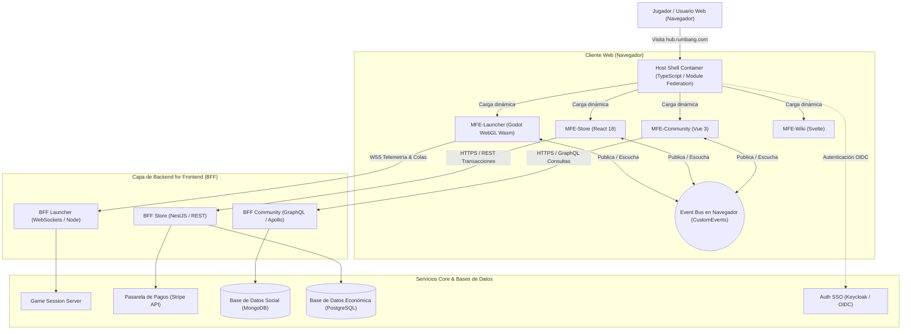
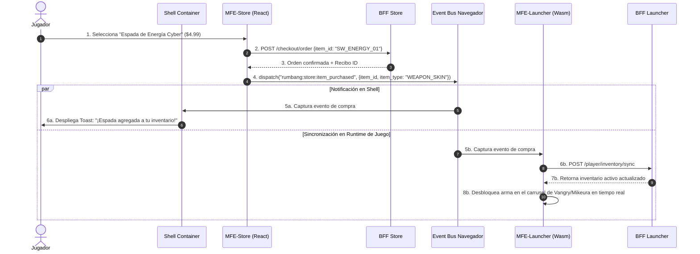

# DOCUMENTO DE ARQUITECTURA DE SOFTWARE: MICRO FRONTENDS
## Plataforma Web Integral del Ecosistema Rumbang ("Rumbang Hub & Online Portal")

---

### METADATOS DEL PROYECTO Y EQUIPO

- **Producto:** Rumbang Online Ecosystem Platform
- **Tipo de Entrega:** Diseño Arquitectónico y Documentación Técnica (Actividad 1)
- **Sector de Negocio:** Gaming, Entretenimiento Digital y E-Sports
- **Énfasis Arquitectónico:** Integración Heterogénea (Wasm/WebGL vs Web Apps), Tiempo Real, Aislamiento de Seguridad en Pagos, Rendimiento y Desacoplamiento por Dominios.
- **Autoría y Roles Asumidos:**
  - **Arquitecto de Dominio (Domain Architect):** Delimitación de Contextos Acotados (DDD), mapeo de rutas, responsabilidades por equipo y discusión crítica frente al monolito modular.
  - **Arquitecto de Integración (Integration Architect):** Matriz de decisión técnica ponderada, contratos de ciclo de vida (montaje/desmontaje) y catálogo exhaustivo de eventos del Event Bus.
  - **Arquitecto de Plataforma y Calidad (Platform & QA Architect):** Temas transversales (CSS Scope, Tokens, Auth/SSO, BFFs), diagramas C4 y de secuencia, matriz de riesgos, mitigaciones y estrategia de testing piramidal (Pact, Unit, E2E).

---

## 1. CONTEXTOS ACOTADOS Y DESCOMPOSICIÓN EN MICRO FRONTENDS

### 1.1 Contexto del Negocio y Justificación Vertical (DDD)
**Rumbang** es un videojuego de acción rápida y supervivencia contra hordas desarrollado originalmente en Godot Engine. La evolución comercial del producto exige una **Plataforma Web Integral** que sirva como portal de entrada para jugadores en navegador, gestión de economía virtual, clanes/comunidad y documentación de estrategia/lore.

Siguiendo los principios de **Domain-Driven Design (DDD)** y las directrices de Michael Geers y Cam Jackson (2019), la descomposición de la plataforma se realiza de manera **estrictamente vertical por capacidades de negocio** y no horizontal por capas técnicas (evitando la clásica división "Equipo UI, Equipo API, Equipo DB"):
- **Autonomía Extremo a Extremo:** Cada equipo es dueño de su lógica de presentación, orquestación de datos y conexión a servicios específicos.
- **Ciclos de Release Desacoplados:** El equipo de la Tienda puede desplegar 10 veces al día para actualizar ofertas o resolver incidencias de pago sin coordinar ni arriesgar la estabilidad del Launcher WebGL del juego o la Wiki.
- **Tolerancia a Fallos:** Si el servicio de estadísticas de clanes o el chat de comunidad falla, el jugador aún puede jugar en el Launcher o comprar en la Tienda sin interrupciones.

```
+---------------------------------------------------------------------------------------------------------+
|                                    HOST SHELL (RUMBANG CONTAINER)                                       |
|               Layout Global, Topbar, Notificaciones, Inyección de Auth JWT y Event Bus Global           |
+-------------------+-------------------+-------------------+-------------------+-------------------------+
|    MFE-LAUNCHER   |     MFE-STORE     |    MFE-COMMUNITY  |      MFE-WIKI     |       MFE-ACCOUNT       |
| (Game Execution)  |  (Economy/Packs)  |   (Clans/Rank)    |  (Weapons/Lore)   |     (Profile/Auth)      |
| Godot Web Wasm/JS |     React 18      |      Vue 3.4      |   Svelte / Lit    |        Vanilla JS       |
+-------------------+-------------------+-------------------+-------------------+-------------------------+
|   BFF Launcher    |     BFF Store     |   BFF Community   |     BFF Wiki      |       BFF Account       |
|    (WebSockets)   |   (REST/Stripe)   | (GraphQL/Sockets) |   (CDN/Cache)     |     (OAuth/OIDC)        |
+-------------------+-------------------+-------------------+-------------------+-------------------------+
```

### 1.2 Catálogo de Micro Frontends Resultantes

| Micro Frontend | Bounded Context (Dominio) | Responsabilidad Principal | Rutas Atendidas | Equipo Dueño | Stack Tecnológico |
| :--- | :--- | :--- | :--- | :--- | :--- |
| **Shell Container** | *Platform Host* | Enrutamiento raíz, Auth SSO, Header/Footer unificado, barra de notificaciones y Event Bus global. | `/`, Rutas raíz | Core Platform Team | TypeScript Nativo + Module Federation Runtime |
| **MFE-Launcher** | *Game Runtime* | Contenedor de ejecución del motor Godot (HTML5/Wasm/WebGL2), telemetría de rendimiento y gestión de sesión activa de partida. | `/play`, `/play/matchmaking` | Game Engine Team | Godot 4 Web Engine + WebAssembly Loader wrapper |
| **MFE-Store** | *Monetization & Economy* | Catálogo de skins, monedas (Oro, Gemas Rumbang), Pases de Batalla, checkout e integración pasarela de pagos. | `/store`, `/store/pass`, `/store/checkout` | Commerce & Monetization Team | React 18 + Zustand + Tailwind CSS |
| **MFE-Community** | *Social & Leaderboards* | Tabla de clasificación mundial, perfiles públicos de supervivientes, chat en vivo de sala y gestión de clanes. | `/leaderboards`, `/clans/*` | Social & Community Team | Vue 3 (Composition API) + Pinia |
| **MFE-Wiki** | *Strategy & Lore* | Base de datos interactiva de armas (árbol de armas, escalado, estrategias de daño), calculador de DPS y biomas. | `/wiki/*`, `/guide/characters` | Content & Editorial Team | SvelteKit (SSG/Client-side) o Lit Web Components |
| **MFE-Account** | *Identity & Security* | Configuración de perfil, seguridad (2FA/OTP), historial de transacciones y personalización de controles. | `/account`, `/account/security` | Security & User Ops Team | TypeScript + Vanilla Web Components |

---

## 2. MATRIZ DE DECISIÓN DEL ENFOQUE DE INTEGRACIÓN

Para seleccionar la estrategia de integración adecuada, se evaluaron cinco enfoques arquitectónicos descritos por Jackson (2019):
1. **Composición en Servidor (SSR / Edge SSI):** Ensamblaje previo al envío al navegador.
2. **Integración en Tiempo de Compilación (Build-Time Packages):** Importación de librerías vía npm/monorepo.
3. **Aislamiento por iframes:** Embebido clásico en tiempo de ejecución.
4. **Composición en Tiempo de Ejecución vía JavaScript (Module Federation):** Carga dinámica de bundles remotos compartiendo runtime.
5. **Web Components nativos en Navegador:** Empaquetado en Custom Elements con Shadow DOM.

### 2.1 Criterios de Evaluación y Ponderación

- **Despliegue Independiente (25%):** Capacidad de desplegar un MFE a producción sin recompilar ni redeployar el contenedor ni otros MFEs.
- **Rendimiento y Shared Dependencies (20%):** Evitar la descarga múltiple de frameworks duplicados y tiempos de carga excesivos.
- **Soporte para Tecnologías Heterogéneas y Wasm (20%):** Facilidad para integrar el binario WebAssembly de Godot junto a interfaces React/Vue.
- **Aislamiento de Seguridad y Fallos (15%):** Evitar que un script vulnerable comprometa transacciones financieras o lea tokens globales.
- **SEO y Accesibilidad (10%):** Indexación de páginas informativas como la Wiki y la Tienda en motores de búsqueda.
- **Simplicidad Operativa y DX (10%):** Facilidad de depuración, desarrollo local y pipeline de CI/CD.

### 2.2 Matriz Ponderada de Decisión

| Criterio | Peso | (1) SSR / Servidor | (2) Build-Time (npm) | (3) iframes | (4) Runtime JS (Module Fed.) | (5) Web Components |
| :--- | :---: | :---: | :---: | :---: | :---: | :---: |
| **Despliegue Independiente** | 25% | 8 (2.00) | 2 (0.50) | 9 (2.25) | **10 (2.50)** | 9 (2.25) |
| **Rendimiento / Deduplicación** | 20% | 8 (1.60) | 9 (1.80) | 3 (0.60) | **9 (1.80)** | 7 (1.40) |
| **Soporte Wasm / Heterogéneo** | 20% | 4 (0.80) | 5 (1.00) | **10 (2.00)** | 8 (1.60) | 8 (1.60) |
| **Aislamiento de Seguridad** | 15% | 7 (1.05) | 4 (0.60) | **10 (1.50)** | 7 (1.05) | 8 (1.20) |
| **SEO y Accesibilidad** | 10% | **10 (1.00)** | 8 (0.80) | 2 (0.20) | 8 (0.80) | 6 (0.60) |
| **Simplicidad Operativa** | 10% | 6 (0.60) | 8 (0.80) | 7 (0.70) | 7 (0.70) | 6 (0.60) |
| **PUNTAJE TOTAL PONDERADO** | **100%** | **7.05** | **5.50** | **7.25** | **8.45** | **7.65** |

### 2.3 Justificación de la Elección: Enfoque Híbrido Primario
El análisis determina una clara superioridad del **Enfoque en Tiempo de Ejecución mediante JavaScript / Module Federation (8.45)**, pero con una **adopción híbrida controlada**:
1. **Núcleo de la Plataforma (Store, Community, Account, Wiki):** Se integran mediante **Module Federation** (Vite / Webpack 5). Permite compartir librerías transversales como `react`, `react-dom` o utilidades comunes sin penalizar el ancho de banda del usuario, manteniendo deploys totalmente independientes por micro-aplicación.
2. **Excepción Arquitectónica para el MFE-Launcher (Godot WebGL Engine):** El motor compilado en WebAssembly requiere su propio contexto de hilo (`SharedArrayBuffer`, headers de aislamiento COOP/COEP `Cross-Origin-Embedder-Policy`). Integrarlo como script plano en el mismo contexto de ventana que la pasarela de pagos generaría conflictos de memoria y bloqueo del hilo principal. Por tanto, el MFE-Launcher se empaqueta como un micro frontend montado con **Web Component wrapper que encapsula un iframe aislado de alto rendimiento**. De este modo, si el WebAssembly crashea por desbordamiento de memoria gráfica o GPU, el Shell y la Tienda continúan 100% funcionales.

---

## 3. CONTRATOS ENTRE EQUIPOS Y COMUNICACIÓN

### 3.1 Contrato Estándar de Ciclo de Vida (Lifecycle Contract)
Cada micro frontend exporta obligatoriamente una interfaz unificada de ciclo de vida para que el contenedor Shell pueda orquestar el renderizado dinámico en el DOM:

```typescript
// Contrato oficial de Micro Frontend: contracts/mfe-lifecycle.ts
export interface MFEContext {
  container: HTMLElement;
  basePath: string;
  authToken: string | null;
  locale: string;
  theme: 'dark' | 'light';
  eventBus: IRumbangEventBus;
}

export interface IRumbangMFE {
  bootstrap(): Promise<void>;
  mount(context: MFEContext): Promise<void>;
  unmount(context: MFEContext): Promise<void>;
  update?(context: Partial<MFEContext>): Promise<void>;
}
```

### 3.2 Catálogo Oficial de Eventos (Event-Driven Communication)
Siguiendo las mejores prácticas para evitar el acoplamiento directo entre micro frontends, no se comparte memoria ni stores globales (como un Redux global único). La comunicación se realiza exclusivamente a través de un **Event Bus desacoplado** montado sobre `window.dispatchEvent` usando `CustomEvent` con esquema versionado:

| Evento | Publicador | Consumidor(es) | Estructura del `detail` (Payload) | Versión |
| :--- | :--- | :--- | :--- | :---: |
| `rumbang:auth:session_changed` | Shell Container / MFE-Account | MFE-Store, MFE-Community, MFE-Launcher | `{ user_id: string, username: string, token: string, roles: string[], expires_at: number }` | `v1.2` |
| `rumbang:wallet:balance_updated` | MFE-Store | Shell Container, MFE-Launcher | `{ currency: 'GOLD' \| 'GEMS', old_amount: number, new_amount: number, transaction_id: string }` | `v1.0` |
| `rumbang:game:match_started` | MFE-Launcher | Shell Container, MFE-Community | `{ match_id: string, map_id: string, character_selected: string, mode: 'SURVIVAL' \| 'BOSS_RUSH', timestamp: number }` | `v1.1` |
| `rumbang:game:match_ended` | MFE-Launcher | MFE-Community, MFE-Account, MFE-Store | `{ match_id: string, survived_time: number, kills: number, gold_earned: number, xp_earned: number, victory: boolean }` | `v1.2` |
| `rumbang:store:item_purchased` | MFE-Store | MFE-Launcher, Shell Container | `{ item_id: string, item_type: 'SKIN' \| 'WEAPON_SKIN' \| 'PASS', price: number, currency: string, new_inventory_ref: string }` | `v1.0` |
| `rumbang:navigation:route_change` | Cualquier MFE | Shell Container | `{ target_path: string, replace?: boolean, state?: Record<string, any> }` | `v1.0` |

### 3.3 Estrategia de Versionado y Compatibilidad Hacia Atrás
Para evitar que un cambio en un payload rompa consumidores no actualizados:
1. **Regla de Adición No Destructiva:** Nuevos campos en `detail` son siempre opcionales.
2. **Propiedad `schema_version` explícita:** En todo evento viaja `version: "1.2"`. Si el cambio es mayor (breaking change), se publica bajo un nuevo canal o evento como `rumbang:game:match_ended:v2`, permitiendo a los suscriptores migrar progresivamente.

### 3.4 Mapeo de Enrutamiento (URL Routing Table)

```
https://hub.rumbang.com/
  ├── /                       -> [Shell Container] Landing page & feed de novedades
  ├── /play/*                 -> [MFE-Launcher] Ejecución de juego WebGL/Wasm y matchmaking
  ├── /store/*                -> [MFE-Store] Catálogo de compras, cofres y pase de batalla
  ├── /leaderboards/*         -> [MFE-Community] Rankings globales y semanales
  ├── /clans/*                -> [MFE-Community] Gestión de clanes y chat de hermandad
  ├── /wiki/*                 -> [MFE-Wiki] Guía de armas, monstruos y fichas de personajes
  └── /account/*              -> [MFE-Account] Seguridad, 2FA y configuración de usuario
```

---

## 4. TEMAS TRANSVERSALES Y GOBERNANZA

### 4.1 Aislamiento de Estilos CSS
- **Problema:** En arquitecturas integradas en el navegador, las reglas globales (`body`, `button`, `.btn`) pueden colisionar violentamente entre micro frontends.
- **Decisión Arquitectónica:**
  1. **Prefijos y CSS Scoping:** En los MFEs de React y Vue se configuran namespaces automáticos vía Tailwind con prefijo dedicado (ej. `tw-store-`, `tw-comm-`) y CSS Modules.
  2. **Shadow DOM para Componentes Nativos:** El Shell y los componentes reutilizables (botones, modales, banners) se renderizan dentro de Shadow DOM encapsulado en Custom Elements, impidiendo fugas de CSS hacia el exterior o interior.
  3. **Reset Prohibido:** Ningún MFE tiene permitido incluir resets destructivos de etiquetas estándar como `* { margin: 0; box-sizing: border-box; }`.

### 4.2 Biblioteca de Componentes Compartidos (Design System "Rumbang UI")
- **Regla Estricta:** La librería compartida contiene **exclusivamente elementos de presentación "tontos" (dumb UI tokens)**. Cero lógica de negocio.
- **Qué ENTRA:** 
  - Tokens CSS (paleta de colores: violeta neón `#6366f1`, cian `#06b6d4`, fondo abisal `#0b0f19`).
  - Botones, inputs, badges de rango, barras de vida/energía estilizadas, modales y tipografías (`Outfit`, `Press Start 2P`).
- **Qué NO ENTRA:**
  - Peticiones HTTP o clientes Axios.
  - Gestión de carrito, cálculo de estadísticas o transformaciones de modelos de juego.
  - Librerías pesadas (ej. Lodash, Moment.js).

### 4.3 Manejo de Autenticación Centralizada (SSO & Token Injection)
- **Dueño de la Sesión:** El **Host Shell Container** es el único responsable de la autenticación. Maneja la cookie segura `HttpOnly`, `SameSite=Strict` y `Secure` con el Identity Provider (Keycloak / Auth0).
- **Mecanismo de Propagación:**
  - El Shell solicita en memoria un Access Token JWT de corta vida (15 minutos).
  - Al montar un MFE, el Shell le pasa el token mediante el objeto `MFEContext`.
  - Cuando el token expira o el usuario cierra sesión, el Shell dispara `rumbang:auth:session_changed`, provocando que todos los micro frontends limpien sus cachés locales al unísono.
  - Los MFEs nunca guardan credenciales ni refresh tokens en `localStorage` (mitigación de ataques XSS).

### 4.4 Patrón Backend For Frontend (BFF)
Para no acoplar los micro frontends a decenas de microservicios de backend con lógica heterogénea, se implementa un **BFF por cada dominio**:

```
[ MFE-Launcher ]       [ MFE-Store ]       [ MFE-Community ]
       |                    |                    |
       v                    v                    v
 [ BFF-Launcher ]     [ BFF-Store ]       [ BFF-Community ]
(FastAPI/WebSockets)  (NestJS / REST)     (Node / GraphQL)
       |                    |                    |
       +--------------------+--------------------+
                            |
           [ API Gateway & Service Mesh (mTLS) ]
                            |
   +-------------+----------+----------+-------------+
   |             |                     |             |
[Game Svc]  [Wallet Svc]         [Social Svc]  [Auth Svc]
```

- **BFF-Launcher:** Optimizado para baja latencia con WebSockets para estado de colas y partidas.
- **BFF-Store:** Orquesta transacciones financieras con Stripe/PayPal, valida inventarios y sanitiza datos de pago.
- **BFF-Community:** Expone un endpoint GraphQL para consultar agregaciones complejas (ej. ver clan + rango del usuario + histórico de temporadas en una sola consulta).

---

## 5. DIAGRAMAS DE ARQUITECTURA

### 5.1 Diagrama C4 - Nivel 2: Contenedores del Sistema
Visualización general del sistema web de Rumbang con sus límites, micro frontends, BFFs y almacenamiento:



### 5.2 Diagrama de Secuencia: Flujo Clave de Compra y Desbloqueo en Partida
Secuencia de interacciones para el caso crítico: El jugador compra un cofre/arma en la tienda web y su nuevo equipamiento se refleja automáticamente en la sesión del launcher sin refrescar la página.



---

## 6. GESTIÓN DE RIESGOS, MITIGACIONES Y ESTRATEGIA DE PRUEBAS

### 6.1 Matriz de Riesgos Arquitectónicos

| ID | Riesgo Identificado | Prob. | Impacto | Estrategia Concreta de Mitigación |
| :---: | :--- | :---: | :---: | :--- |
| **R1** | **Descarga de Múltiples Runtimes y Bloqueo de Ancho de Banda:** Los usuarios en móviles o conexiones lentas descargan React, Vue y el binario Wasm de Godot simultáneamente. | **Alta** | **Alto** | 1. Implementar Module Federation para deduplicar librerías comunes.<br>2. Carga perezosa (*lazy loading* estricto): el binario Wasm de Godot solo se descarga cuando el usuario navega a `/play`.<br>3. Caché agresiva con Service Workers para assets de assets de juego. |
| **R2** | **Fuga de Memoria o Colapso de WebAssembly:** Si el juego WebGL agota la memoria del navegador o crashea el contexto WebGL. | **Media** | **Crítico** | 1. Aislar MFE-Launcher mediante un contenedor con Web Component + iframe con sandbox controlado.<br>2. Monitoreo del contexto WebGL (`webglcontextlost`) con pantalla de reconexión sin tumbar el Shell ni la Tienda. |
| **R3** | **Ruptura de Contratos de Eventos entre Equipos Autónomos:** Un equipo cambia los nombres de propiedades en el `detail` de un evento sin avisar a los demás. | **Media** | **Alto** | 1. Contratos en esquemas TypeScript/JSON Schema compartidos en un paquete npm privado de contratos.<br>2. Pruebas de contrato automatizadas con **Pact** en CI/CD: ningún PR se mergea si rompe el consumidor. |
| **R4** | **Vulnerabilidades de Seguridad en Dependencias de Terceros:** Un ataque XSS en el foro comunitario o la wiki lee datos de tarjetas o sesiones de juego. | **Baja** | **Crítico** | 1. Content Security Policy (CSP) estricta que impide ejecución de scripts no autorizados.<br>2. Tokens de sesión gestionados exclusivamente mediante cookies `HttpOnly` y `SameSite=Strict`.<br>3. iframe sandbox para widgets y código embebido externo. |

### 6.2 Estrategia de Pruebas (Testing Pyramid para Micro Frontends)

```
             / \
            /   \     E2E Integrados (Playwright / Cypress) -> Flujos críticos entre MFEs
           /-----\
          /       \   Pruebas de Contrato (Pact) -> Verificación del Event Bus y APIs BFF
         /---------\
        /           \ Pruebas de Integración de Componentes (Testing Library)
       /-------------\
      /               \ Pruebas Unitarias Aisladas (Vitest / Jest) -> Lógica pura de dominio
     /-----------------\
```

1. **Pruebas Unitarias (Por Repositorio de MFE):** Cada equipo prueba sus componentes, reductores de estado y formateadores con Vitest/Jest sin requerir el Shell.
2. **Pruebas de Contrato (Contract Testing con Pact):** Se mockean las emisiones del Event Bus y las llamadas a los BFFs. El equipo de la Tienda verifica que el MFE-Launcher responderá adecuadamente al evento `rumbang:store:item_purchased`.
3. **Pruebas End-to-End (E2E Sintéticas en Staging):** Ejecución nocturna con Playwright que monta la plataforma completa, navega por el Shell, simula una partida en el Launcher y realiza una compra en la Tienda verificando la consistencia del DOM.

---

## 7. CONTRA-ARGUMENTO CRÍTICO Y RESPUESTA A LA PREGUNTA DIFÍCIL

### 7.1 El Contra-argumento: ¿Por qué para este caso bastaría un Monolito Modular?
> *"El patrón de Micro Frontends no es gratuito; impone un 'impuesto arquitectónico' muy alto en complejidad de infraestructura, orquestación de CI/CD, gobierno de versiones y riesgo de fragmentación visual. Para una organización pequeña o mediana que desarrolla Rumbang, **un Monolito Modular bien estructurado (por ejemplo, con Next.js o Nuxt utilizando carpetas por dominio y límites arquitectónicos forzados con linters)** resolvería el 90% de las necesidades con una fracción del costo operativo.*
>
> *Con un monolito modular, se comparte un único árbol de dependencias optimizado, el SEO es nativo de primer nivel, no existe el riesgo de incompatibilidad de eventos en tiempo de ejecución y la experiencia de desarrollo (DX) local es inmediata, requiriendo un solo `npm run dev` en lugar de levantar 5 servidores locales y un orquestador de Module Federation. Por lo tanto, si la empresa cuenta con menos de 15 desarrolladores, adoptar micro frontends es sobreingeniería perjudicial."*

### 7.2 Conclusión Final y Respuesta a la Pregunta Difícil del Escenario
**La Pregunta Difícil:**
*¿Cómo garantizamos un rendimiento visual impecable de 60 FPS en el Launcher WebGL (Wasm) de Rumbang mientras convive en el mismo producto web con micro frontends de interfaces dinámicas como la Tienda y la Comunidad, sin que compitan por los recursos del hilo principal ni degraden la experiencia de juego?*

**Respuesta Arquitectónica Concluyente:**
La respuesta radica en **no forzar la paridad técnica sobre dominios con naturalezas de ejecución incompatibles**:
1. **Aislamiento de Hilo de Ejecución:** El motor Godot WebAssembly se ejecuta en un contexto protegido donde se activan `SharedArrayBuffer` y soporte multihilo a través de Web Workers dedicados (`godot.worker.js`).
2. **Desconexión del Renderloop:** Cuando el usuario interactúa con el Launcher, el Host Shell suspende temporalmente las suscripciones de polling de los micro frontends en segundo plano (como el feed de la comunidad o carruseles animados de la tienda), liberando los ciclos de CPU y GPU para el canvas del juego.
3. **Integración Asíncrona vía Eventos:** La interfaz de usuario del juego no manipula directamente el DOM de la página; utiliza un canal serializado de mensajería (`postMessage` tipado a través de nuestro Event Bus wrapper) para notificar victorias, oro y compras.

De este modo, se obtiene lo mejor de ambos mundos: la escalabilidad y velocidad comercial de despliegue de **Micro Frontends** para la web, combinada con la potencia y contención de recursos de un motor de videojuegos de alto rendimiento.
